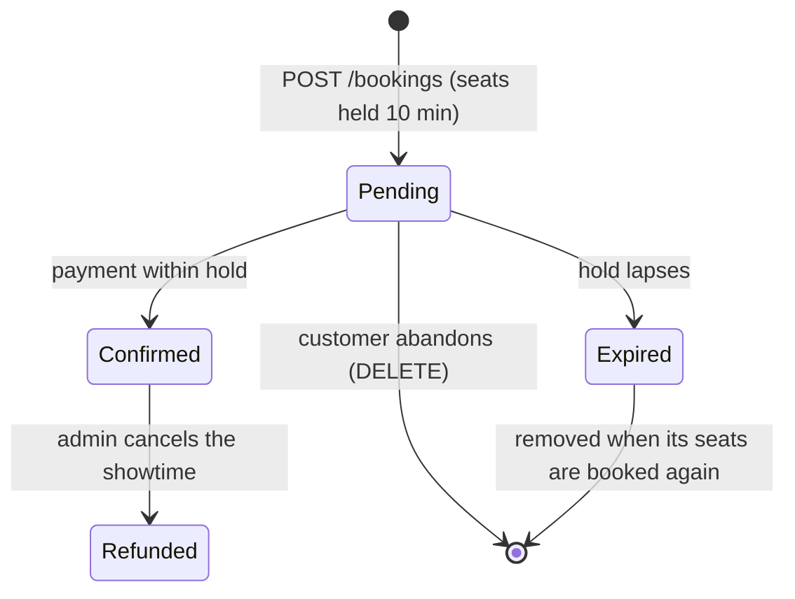

# Cinema Booking API

[](https://github.com/14m6d4/se-phase-01/actions/workflows/ci.yml)


[](LICENSE)

A REST backend for a cinema chain: admins run the catalogue (cinemas, auditoriums, movies, showtimes), customers hold seats and pay for them. Built as the phase 1 project of the Software Architecture course at VNU University of Engineering and Technology (UET).

## Table of contents

- [Assignment requirements](#assignment-requirements)
- [Documentation](#documentation)
- [Features](#features)
- [Tech stack](#tech-stack)
- [Architecture](#architecture)
- [Getting started](#getting-started)
- [Configuration](#configuration)
- [API overview](#api-overview)
- [Booking lifecycle](#booking-lifecycle)
- [Testing](#testing)
- [Performance](#performance)
- [CI/CD](#cicd)
- [Project structure](#project-structure)
- [Known issues](#known-issues)
- [License](#license)

## Assignment requirements

| Requirement | Where it is met |
|---|---|
| REST + JSON with POST, GET and DELETE | [API overview](#api-overview) |
| OpenAPI / Swagger specification | springdoc, Swagger UI at `/swagger-ui.html`, exported as [`docs/openapi.json`](docs/openapi.json) |
| Layered architecture, business layer free of web and DB imports | `api` → `business` → `persistence`, enforced by an ArchUnit test ([ADR 0001](docs/adr/0001-framework-free-business-layer.md)) |
| Repository / data access layer with an ORM | Spring Data JPA (Hibernate) adapters implementing business-layer repository interfaces |
| Login, at least one authenticated GET and POST | JWT login; `GET /api/bookings`, `POST /api/bookings` and more |
| Authentication through framework middleware | Spring Security filter chain, access rules declared once in `SecurityConfig` |
| Docker | Multi-stage [`Dockerfile`](Dockerfile), [`docker-compose.yml`](docker-compose.yml), image published to GHCR |
| Load test on a Kaggle CPU notebook | [`loadtest/`](loadtest/README.md) with k6 ([ADR 0003](docs/adr/0003-load-test-on-kaggle-without-docker.md)), results in [`docs/loadtest-baseline.md`](docs/loadtest-baseline.md) |

## Documentation

| Document | What it covers |
|---|---|
| [`GLOSSARY.md`](GLOSSARY.md) | Domain terms: Cinema, Showtime, Booking, Hold, Refunded and the rest |
| [`docs/openapi.json`](docs/openapi.json) | OpenAPI 3.1 specification of every endpoint, request, response and error |
| [Swagger UI (static)](https://tretrauit.me/se-phase-01/swagger.html) | The same specification, browsable online. It documents the API but cannot send requests |
| [`docs/booking-walkthrough.md`](docs/booking-walkthrough.md) | Step-by-step booking demo in Swagger UI or with `curl` |
| [`docs/adr/`](docs/adr/) | Architecture decisions and why they were made |
| [`docs/loadtest-baseline.md`](docs/loadtest-baseline.md) | Accepted Kaggle load-test results |

## Features

**Catalogue management (admin)**
- Cinemas and auditoriums. Each auditorium gets a seat layout generated from its size (up to 26 rows), with rows marked as standard, VIP or couple seats.
- Movies and showtimes. The end of a showtime is computed from the movie's length plus 15 minutes of cleaning, and showtimes in the same auditorium can't overlap.
- Showtime cancellation with a reason (equipment failure, power outage, emergency, other). Paid bookings are refunded and unpaid ones are released, all in one transaction.

**Booking (customer)**
- Self-registration and JWT login.
- Browse showtimes by date, cinema and movie, and view a live seat map with availability and prices.
- Book 1 to 8 seats per booking. Seats are held for 10 minutes until payment (simulated).
- Concurrency-safe: a database unique constraint guarantees a seat is never sold twice, even under heavy contention.

**Platform**
- OpenAPI 3 documentation with Swagger UI.
- Consistent error responses in [RFC 9457](https://www.rfc-editor.org/rfc/rfc9457) Problem Details format.
- Versioned schema migrations with Flyway.
- Health and metrics endpoints via Spring Boot Actuator.
- Containerised with Docker; the image is published to GitHub Container Registry.

## Tech stack

| Area | Technology |
|---|---|
| Language & runtime | Java 21 |
| Framework | Spring Boot 4.1 (Web MVC, Validation, Actuator) |
| Security | Spring Security, OAuth2 Resource Server (HS256 JWT), BCrypt |
| Persistence | Spring Data JPA / Hibernate, PostgreSQL 17, Flyway |
| API documentation | springdoc-openapi, Swagger UI |
| Testing | JUnit 5, Testcontainers, ArchUnit |
| Build & delivery | Maven Wrapper, Docker, GitHub Actions, GHCR |
| Load testing | k6 |

## Architecture

The service is a single deployable organised as a **layered architecture**, one package per layer under `vn.edu.uet.cinema`.


| Layer | Responsibility | Allowed dependencies |
|---|---|---|
| `api` | Maps HTTP to use cases, validates input, renders errors | `business`, Spring Web |
| `business` | Domain rules and use cases | JDK only |
| `persistence` | Implements the business repository interfaces with JPA | `business`, JPA |
| `config` | Security rules, bean wiring, OpenAPI | everything |

Key design decisions:

- **Framework-free business layer.** The domain has no Spring, JPA or web imports. It owns the repository interfaces, and the persistence layer implements them (dependency inversion). This keeps business rules easy to read and to unit test.
- **Enforced boundaries.** `ArchitectureTest` (ArchUnit) fails the build when a layer rule is broken, so the architecture can't drift silently.
- **Authentication as middleware.** JWTs are validated by Spring Security's filter chain. All access rules live in `config/SecurityConfig.java`; controllers contain no auth logic.
- **Seat contention handled by the database.** Booked seats carry a `UNIQUE(showtime_id, seat_id)` constraint. Concurrent requests race on the insert and the loser gets a `409`, with no application-level locks. Expired holds are cleaned up lazily the next time someone books one of their seats.

## Getting started

### Prerequisites

- Docker with Docker Compose, or
- JDK 21 and PostgreSQL 17 to run the app outside a container.

### Quick start with Docker Compose

```bash
git clone https://github.com/14m6d4/se-phase-01.git
cd se-phase-01
cp .env.example .env          # set your own secrets in .env
docker compose up --build
```

The service is ready when the log shows `Started CinemaApplication`. The [booking walkthrough](docs/booking-walkthrough.md) exercises it end to end.

| URL | Purpose |
|---|---|
| http://localhost:8080/swagger-ui.html | Interactive API docs |
| http://localhost:8080/v3/api-docs | OpenAPI specification (JSON; `/v3/api-docs.yaml` for YAML) |
| http://localhost:8080/actuator/health | Health check |

An admin account is created on startup from `ADMIN_EMAIL` / `ADMIN_PASSWORD`. Compose refuses to start if a required variable is missing, and both services bind to `127.0.0.1` only.

To run the image CI published from `main` instead of building locally:

```bash
docker compose pull app
docker compose up --no-build
```

### Running locally

Start only the database in Docker, then run the app with Maven:

```bash
docker compose up -d db
set -a; source .env; set +a   # export the variables from .env
./mvnw spring-boot:run
```

From an IDE, run `TestCinemaApplication` in `src/test`. It starts PostgreSQL in a container automatically. Set `JWT_SECRET` and `ADMIN_PASSWORD` in the run configuration.

## Configuration

All configuration is read from environment variables. Secrets have no defaults and must be provided.

| Variable | Required | Default | Description |
|---|:---:|---|---|
| `DB_URL` | | `jdbc:postgresql://localhost:5432/cinema` | JDBC URL |
| `DB_USERNAME` | | `cinema` | Database user |
| `DB_PASSWORD` | ✓ | | Database password |
| `JWT_SECRET` | ✓ | | HS256 signing key, at least 32 bytes (`openssl rand -base64 32`) |
| `ADMIN_EMAIL` | | `admin@cinema.local` | Admin account, created or updated at startup |
| `ADMIN_PASSWORD` | ✓ | | Admin password; change it and restart to rotate |

## API overview

Base path: `/api`. Full request and response schemas are in Swagger UI.

| Resource | Endpoint | Access |
|---|---|---|
| **Auth** | `POST /auth/register` | Public |
| | `POST /auth/login` | Public |
| | `GET /me` | Authenticated |
| **Cinemas** | `GET /cinemas`, `GET /cinemas/{id}` | Public |
| | `POST /cinemas`, `PUT /cinemas/{id}`, `DELETE /cinemas/{id}` | Admin |
| **Auditoriums** | `GET /cinemas/{id}/auditoriums`, `GET /auditoriums/{id}` | Public |
| | `POST /cinemas/{id}/auditoriums`, `DELETE /auditoriums/{id}` | Admin |
| **Movies** | `GET /movies`, `GET /movies/{id}` | Public |
| | `POST /movies`, `PUT /movies/{id}`, `DELETE /movies/{id}` | Admin |
| **Showtimes** | `GET /showtimes?date=&cinemaId=&movieId=` | Public |
| | `GET /showtimes/{id}`, `GET /showtimes/{id}/seats` | Public |
| | `POST /showtimes`, `DELETE /showtimes/{id}` | Admin |
| | `POST /showtimes/{id}/cancellation` | Admin |
| **Bookings** | `GET /bookings`, `GET /bookings/{id}` | Customer |
| | `POST /bookings`, `DELETE /bookings/{id}` | Customer |
| | `POST /bookings/{id}/payment` | Customer |

### Authentication

Log in to get a bearer token (valid for one hour), then send it in the `Authorization` header:

```bash
curl -X POST localhost:8080/api/auth/register -H 'Content-Type: application/json' \
  -d '{"email":"alice@example.com","password":"password123","fullName":"Alice"}'

TOKEN=$(curl -s -X POST localhost:8080/api/auth/login -H 'Content-Type: application/json' \
  -d '{"email":"alice@example.com","password":"password123"}' | jq -r .accessToken)

curl localhost:8080/api/me -H "Authorization: Bearer $TOKEN"
```

In Swagger UI, call `POST /api/auth/login`, click **Authorize** and paste the `accessToken`.

### Errors

Every error is returned as `application/problem+json`:

| Status | Meaning |
|---|---|
| `400` | Invalid request body or parameters |
| `401` | Missing, invalid or expired token |
| `403` | Authenticated but lacking the required role |
| `404` | Resource not found (including another customer's booking) |
| `409` | Business rule violation, e.g. seat already taken, overlapping showtime, hold expired |

### Conventions

- Money is an integer amount in VND.
- Timestamps are ISO-8601 with offset. The service runs on `Asia/Ho_Chi_Minh`, and `?date=` covers that calendar day in Vietnam time.

## Booking lifecycle



Pricing is copied into the booking when it is created, so later price changes don't affect it:

| Seat type | Price |
|---|---|
| Standard | base price |
| VIP | base price + 20,000 VND |
| Couple | 2 × base price + 10,000 VND |

Other rules: a customer can have only one live pending booking at a time, a showtime can't be booked once it has started, and paying an already confirmed booking is idempotent.

To see the whole lifecycle on a running service, follow the [booking walkthrough](docs/booking-walkthrough.md).

## Testing

```bash
./mvnw verify
```

Docker must be running: integration tests start a real PostgreSQL through Testcontainers. The suite covers:

- **Unit tests** for the business layer, which needs no Spring context.
- **Integration tests** for controllers and repositories against PostgreSQL.
- **Architecture tests** (ArchUnit) for the layer rules.
- **Contract tests** checking that the generated OpenAPI specification lists every operation, error response and security requirement.

## Performance

Accepted Kaggle baseline (kernel version 5) with [k6](https://k6.io/) on a Kaggle CPU notebook, with the service, PostgreSQL and k6 sharing the machine. The run used the source snapshot identified in [`docs/loadtest-baseline.md`](docs/loadtest-baseline.md), the notebook's native `CODE_BUNDLE="auto"`, `RATE=50`, `DURATION=60s` and k6 v2.3.0; runtime details are in the run's `results/env.txt`.

| Scenario | Workflow | Throughput | p50 | p95 | p99 | Error rate |
|---|---|---:|---:|---:|---:|---:|
| browse | list showtimes → open seat map | 79.9 req/s | 3.51 ms | 5.75 ms | 9.09 ms | 0% |
| book | hold seats → pay | 78.3 req/s | 7.98 ms | 11.47 ms | 15.75 ms | 0% |
| contention | many customers race for the same 10 seats | 37.0 req/s | 9.09 ms | 11.54 ms | 12.99 ms | 0% |

Under contention, exactly 10 bookings succeeded and 3,989 attempts received the expected `409` conflicts; a SQL check after the run confirmed no seat was sold twice. Compare another run only against its recorded `results/env.txt`.

Scenarios, seed data and instructions for reproducing the run are in [`loadtest/`](loadtest/README.md).

## CI/CD

GitHub Actions ([`ci.yml`](.github/workflows/ci.yml)) runs on every pull request and every push to `main`:

1. Runs the load-test helper checks and `./mvnw verify` (unit, integration and architecture tests).
2. On `main`, builds the Docker image and publishes it to `ghcr.io/14m6d4/se-phase-01:latest`.

## Project structure

```
.
├── src/
│   ├── main/
│   │   ├── java/vn/edu/uet/cinema/
│   │   │   ├── api/            # REST controllers, DTOs, exception → ProblemDetail
│   │   │   ├── business/       # domain models, services, repository interfaces
│   │   │   ├── persistence/    # JPA entities, Spring Data repositories, adapters
│   │   │   └── config/         # security, bean wiring, OpenAPI
│   │   └── resources/
│   │       └── db/migration/   # Flyway migrations
│   └── test/                   # unit, integration and architecture tests
├── loadtest/                   # k6 scenarios, seed data, Kaggle notebook
├── .github/workflows/          # CI pipeline
├── Dockerfile                  # multi-stage build
└── docker-compose.yml          # app + PostgreSQL
```

## Known issues

Problems in the current phase 1 system, left for phase 2 to improve.

**Booking and concurrency**
- **Seat hoarding.** A Hold claims its Seats whether or not it is ever paid. Registration is open, with no email verification and no rate limit, so many accounts can keep a Showtime's Seats held without buying ([ADR 0004](docs/adr/0004-seat-contention-via-unique-constraint-and-lazy-holds.md)).
- **Lapsed Holds linger.** Expiry is lazy: a lapsed Hold stays in the database until someone books one of its Seats. Nothing cleans up the rest.
- **No booking history.** Abandoned and Expired Bookings are deleted, so they cannot be analysed later.
- **One concurrency strategy measured.** Only the unique-constraint approach was load tested; pessimistic locking, optimistic locking and queue-based booking were not compared.
- **Cancellation side effects.** Cancelling a Showtime briefly blocks new bookings of it, and a Cancelled Showtime with Refunded Bookings can never be deleted ([ADR 0005](docs/adr/0005-showtime-cancellation-in-one-adapter-transaction.md)).

**Security**
- **Tokens cannot be revoked.** JWTs are signed with one shared HS256 secret and stay valid for their full hour; there is no refresh token and no logout.
- **No rate limiting** on login, registration or booking, so passwords can be brute-forced and endpoints flooded.
- **One Admin.** The only Admin comes from environment variables; there is no way to add Admins, audit their actions, or rotate the password without a restart.
- **No CORS configuration.** A browser frontend on another origin cannot call the API.

**API**
- **No pagination.** `GET /movies`, `GET /cinemas` and `GET /bookings` return every row.
- **Loose response types in the specification.** Success responses are documented as `*/*` instead of `application/json`.
- **API docs always public.** Swagger UI and `/v3/api-docs` are exposed in every environment.

**Operations and performance**
- **Single instance, manual hosting.** CI publishes an image but nothing deploys it, and the static Swagger UI cannot send requests.
- **Capacity unknown.** The baseline only covers 50 iterations/s, with the service, PostgreSQL and k6 sharing one Kaggle machine. The maximum throughput and the bottleneck were not measured, and the contention scenario does not synchronise requests into one simultaneous race ([baseline](docs/loadtest-baseline.md)).
- **Untuned defaults.** The connection pool keeps Hikari's default of 10 connections, and the JVM runs without flags.
- **Thin observability.** Actuator exposes health and metrics only; there is no tracing, structured logging or alerting.

**Codebase**
- **Two model sets.** Business models and JPA entities are separate, joined by hand-written mappers ([ADR 0001](docs/adr/0001-framework-free-business-layer.md)).
- **Rules kept in two places.** Delete guards and the Showtime overlap rule live in both the business layer and the database, and must be changed together ([ADR 0006](docs/adr/0006-delete-guards-in-business-and-database.md)).

## License

Released under the [MIT License](LICENSE).
