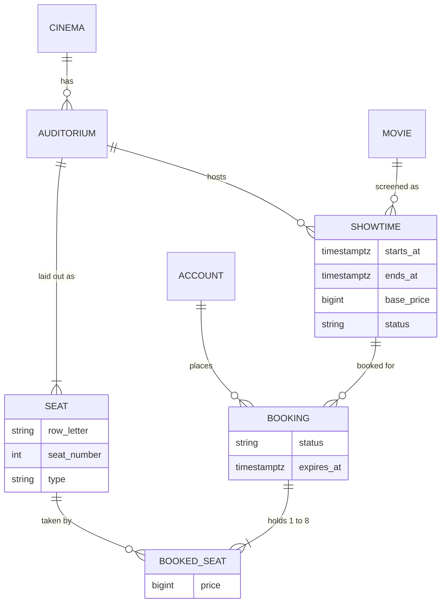
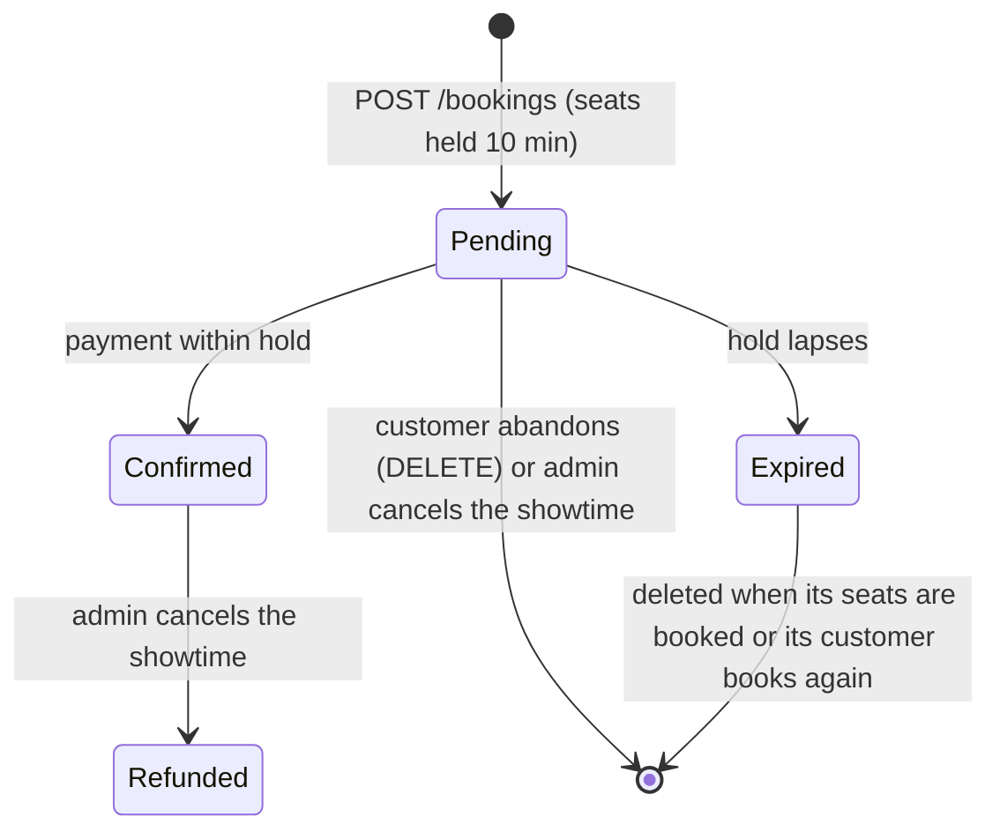
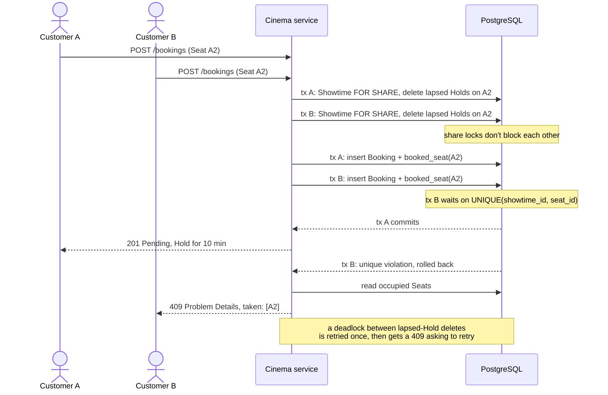

<div align="center">

# Cinema Booking API

[](#tech-stack)

[](https://github.com/14m6d4/se-phase-01/actions/workflows/ci.yml)
[](docs/openapi.json)
[](https://github.com/14m6d4/se-phase-01/pkgs/container/se-phase-01)
[](LICENSE)


A REST backend for a cinema chain. Admins run the catalogue of cinemas, auditoriums, movies and showtimes; customers hold seats and pay for them. It is the phase 1 project of the Software Architecture course at VNU University of Engineering and Technology (UET).

</div>

## Table of contents

- [Features](#features)
- [Domain model](#domain-model)
- [Booking lifecycle](#booking-lifecycle)
- [Architecture](#architecture)
- [Assignment requirements](#assignment-requirements)
- [Tech stack](#tech-stack)
- [Getting started](#getting-started)
- [API overview](#api-overview)
- [Testing](#testing)
- [Performance](#performance)
- [CI/CD](#cicd)
- [Known issues](#known-issues)
- [Documentation](#documentation)
- [License](#license)

## Features

**Catalogue management (Admin)**
- Cinemas and auditoriums. An auditorium's seat layout is generated from its size (up to 26 rows), and each row is Standard, VIP or Couple.
- Movies and showtimes. A showtime ends after the movie's length plus 15 minutes of cleaning, and two showtimes in the same auditorium can't overlap.
- Showtime cancellation with a reason (equipment failure, power outage, emergency, other). One transaction refunds the paid bookings and releases the unpaid ones.

**Booking (Customer)**
- Self-registration and JWT login.
- Showtimes filtered by date, cinema and movie, and a live seat map with availability and prices.
- 1 to 8 seats per booking, held for 10 minutes until payment (simulated).
- A database unique constraint stops a seat from being sold twice, including when many customers race for it.

**Platform**
- OpenAPI 3.1 documentation with Swagger UI.
- Every error in [RFC 9457](https://www.rfc-editor.org/rfc/rfc9457) Problem Details format.
- Versioned schema migrations with Flyway.
- Health and metrics endpoints through Spring Boot Actuator.
- A Docker image, published to GitHub Container Registry.

## Domain model



The database enforces three rules on its own:

- `booked_seat` has `UNIQUE(showtime_id, seat_id)`, so a seat is booked at most once per showtime.
- A partial unique index allows one `PENDING` booking per customer.
- An exclusion constraint rejects overlapping showtimes in the same auditorium, ignoring cancelled ones.

[`GLOSSARY.md`](GLOSSARY.md) defines each term (Hold, Pending, Refunded and the rest).

## Booking lifecycle



Each booked seat keeps the price it had when the booking was made, so later price changes don't affect it:

| Seat type | Price |
|---|---|
| Standard | base price |
| VIP | base price + 20,000 VND |
| Couple | 2 × base price + 10,000 VND |

A customer can have only one live pending booking at a time, a showtime can't be booked once it has started, and paying a confirmed booking again returns it unchanged. The [booking walkthrough](docs/booking-walkthrough.md) runs the whole lifecycle on a live service.

## Architecture

The service is one deployable with a layered architecture, one package per layer under `vn.edu.uet.cinema`.


| Layer | Responsibility | Allowed dependencies |
|---|---|---|
| `api` | Maps HTTP to use cases, validates input, renders errors | `business`, Spring Web |
| `business` | Domain rules and use cases | JDK only |
| `persistence` | Implements the business repository interfaces with JPA | `business`, JPA |
| `config` | Security rules, bean wiring, OpenAPI | everything |

Design decisions:

- The business layer imports no Spring, JPA or web code. It owns the repository interfaces and the persistence layer implements them, so business rules can be read and unit tested on their own ([ADR 0001](docs/adr/0001-framework-free-business-layer.md)).
- `ArchitectureTest` (ArchUnit) fails the build when a layer imports a package it is not allowed to.
- Spring Security's filter chain validates the JWT before any controller runs. Every access rule is in `config/SecurityConfig.java`, and controllers have no auth code.
- The database settles seat contention. Concurrent bookings race on the `booked_seat` insert, the loser gets a `409`, and there are no application locks. A lapsed hold is deleted the next time someone books one of its seats ([ADR 0004](docs/adr/0004-seat-contention-via-unique-constraint-and-lazy-holds.md)).

When two Customers want the same Seat, the unique index decides who gets it:



## Assignment requirements

| Requirement | Where it is met |
|---|---|
| REST + JSON with POST, GET and DELETE | [API overview](#api-overview) |
| OpenAPI / Swagger specification | springdoc, Swagger UI at `/swagger-ui.html`, exported as [`docs/openapi.json`](docs/openapi.json) |
| Layered architecture, business layer free of web and DB imports | `api` → `business` → `persistence`, enforced by an ArchUnit test ([ADR 0001](docs/adr/0001-framework-free-business-layer.md)) |
| Repository / data access layer with an ORM | Spring Data JPA (Hibernate) adapters implementing business-layer repository interfaces |
| Login, at least one authenticated GET and POST | JWT login; `GET /api/bookings`, `POST /api/bookings` and more |
| Authentication through framework middleware | Spring Security filter chain, access rules declared once in `SecurityConfig` |
| Docker | Multi-stage [`Dockerfile`](Dockerfile), [`docker-compose.yml`](docker-compose.yml), image published to GHCR |
| Load test on a Kaggle CPU notebook | [`loadtest/`](loadtest/README.md) with k6 ([ADR 0003](docs/adr/0003-load-test-on-kaggle-without-docker.md)), results in [`docs/loadtest-baseline.md`](docs/loadtest-baseline.md) |

## Tech stack

| Area | Technology |
|---|---|
| Language & runtime | Java 21 |
| Framework | Spring Boot 4.1 (Web MVC, Validation, Actuator) |
| Security | Spring Security 7, OAuth2 Resource Server (HS256 JWT), BCrypt |
| Persistence | Spring Data JPA / Hibernate 7, PostgreSQL 17, Flyway |
| API documentation | springdoc-openapi, Swagger UI |
| Testing | JUnit 6, Testcontainers, ArchUnit |
| Build & delivery | Maven Wrapper, Docker, GitHub Actions, GHCR |
| Load testing | k6 |

## Getting started

You need Docker with Docker Compose.

```bash
git clone https://github.com/14m6d4/se-phase-01.git
cd se-phase-01
cp .env.example .env          # set your own secrets in .env
docker compose up --build
```

The service is ready when the log shows `Started CinemaApplication`.

| URL | Purpose |
|---|---|
| http://localhost:8080/swagger-ui.html | Interactive API docs |
| http://localhost:8080/v3/api-docs | OpenAPI specification (JSON; `/v3/api-docs.yaml` for YAML) |
| http://localhost:8080/actuator/health | Health check |

The Admin account comes from `ADMIN_EMAIL` and `ADMIN_PASSWORD` at startup. Compose refuses to start if a required variable is missing, and both containers listen on `127.0.0.1` only.

The [development guide](docs/development.md) covers running without Compose, every environment variable, a `curl` login example and the project layout.

## API overview

Base path: `/api`. Swagger UI and [`docs/openapi.json`](docs/openapi.json) have the full request and response schemas.

| Resource | Endpoint | Access |
|---|---|---|
| **Auth** | `POST /auth/register` | Public |
| | `POST /auth/login` | Public |
| | `GET /me` | Authenticated |
| **Cinemas** | `GET /cinemas`, `GET /cinemas/{id}` | Public |
| | `POST /cinemas`, `PUT /cinemas/{id}`, `DELETE /cinemas/{id}` | Admin |
| **Auditoriums** | `GET /cinemas/{id}/auditoriums`, `GET /auditoriums/{id}` | Public |
| | `POST /cinemas/{id}/auditoriums`, `DELETE /auditoriums/{id}` | Admin |
| **Movies** | `GET /movies`, `GET /movies/{id}` | Public |
| | `POST /movies`, `PUT /movies/{id}`, `DELETE /movies/{id}` | Admin |
| **Showtimes** | `GET /showtimes?date=&cinemaId=&movieId=` | Public |
| | `GET /showtimes/{id}`, `GET /showtimes/{id}/seats` | Public |
| | `POST /showtimes`, `DELETE /showtimes/{id}` | Admin |
| | `POST /showtimes/{id}/cancellation` | Admin |
| **Bookings** | `GET /bookings`, `GET /bookings/{id}` | Customer |
| | `POST /bookings`, `DELETE /bookings/{id}` | Customer |
| | `POST /bookings/{id}/payment` | Customer |

A login returns a bearer token valid for one hour; send it as `Authorization: Bearer <token>`. Every error is `application/problem+json`:

| Status | Meaning |
|---|---|
| `400` | Invalid request body or parameters |
| `401` | Missing, invalid or expired token |
| `403` | Authenticated but lacking the required role |
| `404` | Resource not found (including another customer's booking) |
| `409` | Business rule violation, e.g. seat already taken, overlapping showtime, hold expired |

Money is an integer amount in VND. Timestamps are ISO-8601 with an offset. The service runs on `Asia/Ho_Chi_Minh`, and `?date=` covers that calendar day in Vietnam time.

## Testing

```bash
./mvnw verify
```

Docker must be running, because the integration tests start a real PostgreSQL through Testcontainers. The suite has four kinds of test:

- Unit tests for the business layer, which need no Spring context.
- Integration tests for controllers and repositories against PostgreSQL.
- Architecture tests (ArchUnit) for the layer rules.
- Contract tests checking that the generated OpenAPI specification lists every operation, error response and security requirement.

## Performance

The current capacity baseline uses [k6](https://k6.io/) v2.3.0 on two independent public Kaggle CPU notebooks. The service, PostgreSQL and k6 share each notebook, with k6 pinned to one CPU and the service plus PostgreSQL on CPUs 1-3. [`docs/loadtest-baseline.md`](docs/loadtest-baseline.md) records the source snapshot, stepped results, telemetry and comparison. Rates are in it/s, completed workflows per second; browse and book make two HTTP requests per workflow.


| Scenario | Highest held, it/s (Run 1 / Run 2) | Gave out first |
|---|---:|---|
| account | 1,200 / 1,200 | Application request queue (Tomcat threads, Hikari pending) |
| browse | 400 / 400 | Inconclusive: k6 at 92-93% of its one core |
| book | 50 / none | Not identified; high iowait is the first lead |
| contention | 200 / 400 | PostgreSQL and app contention on the seat-status query |
| race | 200 / 300 | PostgreSQL and app contention on the seat-status query |

These are the highest configured steps that held under the baseline rules. They are not a measure of the service's maximum capacity. All 21 contention and race steps passed SQL verification: no Seat was booked twice, and the `201` and `409` counts add up. Under contention, the query that reads a Showtime's taken Seats (`booking` joined with `booked_seat`) used 51-149 s of database time per step, which makes it the first target for phase 2.

[`loadtest/`](loadtest/README.md) has the scenarios, seed data and reproduction steps.

## CI/CD

GitHub Actions ([`ci.yml`](.github/workflows/ci.yml)) runs on pull requests and on pushes to `main`. A change that touches only `docs/`, Markdown files or `LICENSE` skips it.

1. The `verify` job runs the load-test helper checks and `./mvnw verify`.
2. On a push to `main`, the `image` job builds the Docker image and pushes it to `ghcr.io/14m6d4/se-phase-01`, tagged `latest` and with the commit SHA.

## Known issues

Phase 1 deliberately stops short of these; phase 2 reruns the [load test](docs/loadtest-baseline.md) to measure each change.

| Issue | Severity | Impact | Phase 2 direction |
|---|---|---|---|
| Seat hoarding | High | Many free accounts can together keep a Showtime's Seats held without paying | Rate-limit holds, verify email before booking |
| Simulated payment | High | No gateway: payments can't fail and refunds move no money | Integrate a payment gateway; make charges and refunds idempotent |
| Tokens can't be revoked | High | A leaked token works for its full hour; no logout | Short-lived access tokens plus revocable refresh tokens |
| No rate limiting | High | Login can be brute-forced and endpoints flooded | Per-IP and per-account limits |
| One Admin | Medium | The Admin comes from env vars; no audit; rotating the password needs a restart | Admin management and an audit log |
| Seat contention settled by the database alone | Medium | Under contention the service holds 200-400 it/s, and most database time goes to reading which Seats are taken | Cheaper seat-status reads, then compare pessimistic locking, optimistic locking and a booking queue ([ADR 0004](docs/adr/0004-seat-contention-via-unique-constraint-and-lazy-holds.md)) |
| Seat layouts re-read every request | Medium | The most expensive browse query, though a layout never changes | Cache layouts per Auditorium |
| Single instance | Medium | No failover or horizontal scaling; CI publishes an image but nothing deploys it | Several instances behind a load balancer |
| Thin observability | Low | Health and metrics only | Tracing, structured logs, alerts |
| No pagination | Low | `GET /movies`, `/cinemas` and `/bookings` return every row | `page` and `size` parameters |

## Documentation

| Document | What it covers |
|---|---|
| [`GLOSSARY.md`](GLOSSARY.md) | Domain terms: Cinema, Showtime, Booking, Hold, Refunded and the rest |
| [`docs/openapi.json`](docs/openapi.json) | OpenAPI 3.1 specification of every endpoint, request, response and error |
| [`docs/booking-walkthrough.md`](docs/booking-walkthrough.md) | Step-by-step booking demo in Swagger UI or with `curl` |
| [`docs/development.md`](docs/development.md) | Running without Compose, configuration, project layout |
| [`docs/adr/`](docs/adr/) | Architecture decisions and why they were made |
| [`docs/loadtest-baseline.md`](docs/loadtest-baseline.md) | Accepted Kaggle load-test results |
| [`loadtest/README.md`](loadtest/README.md) | Load-test scenarios, seed data, and how to run them locally or on Kaggle |

## License

Released under the [MIT License](LICENSE).
