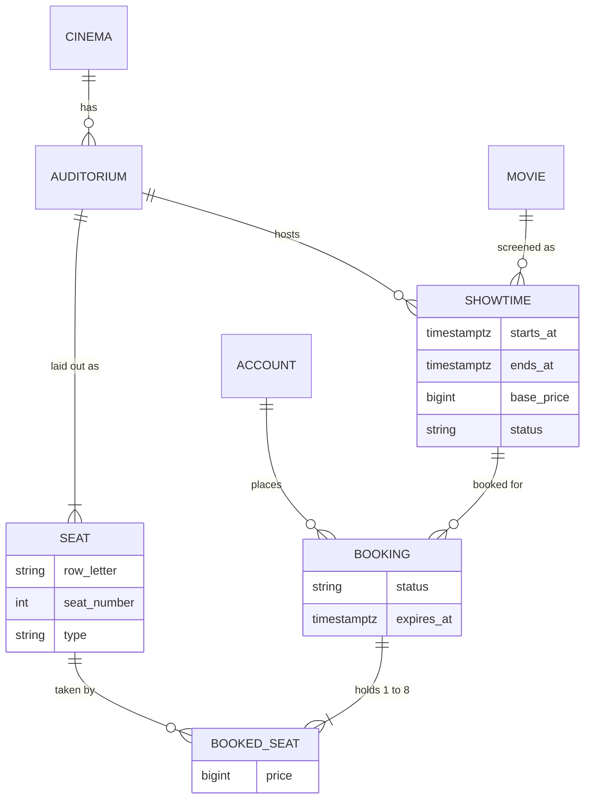
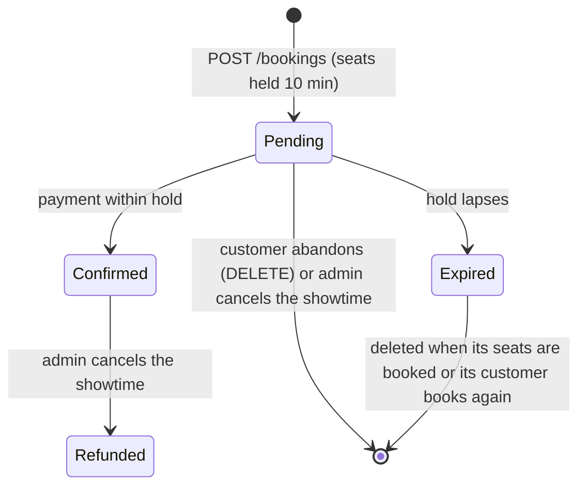
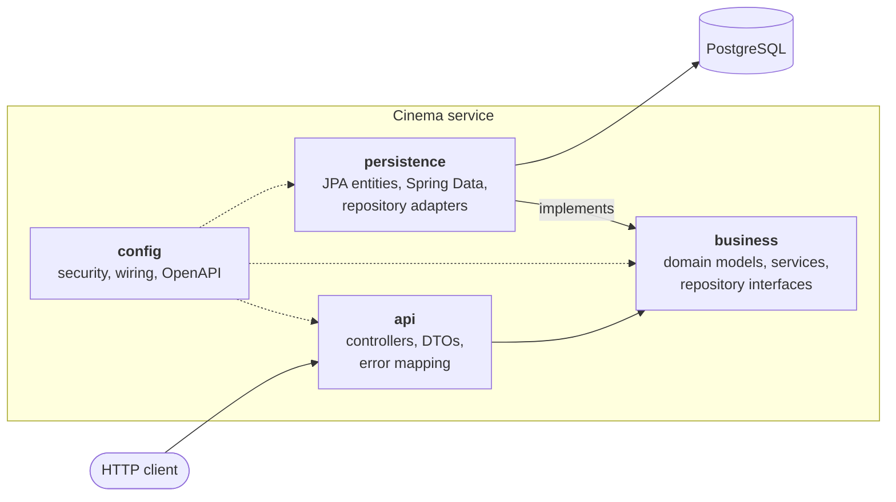
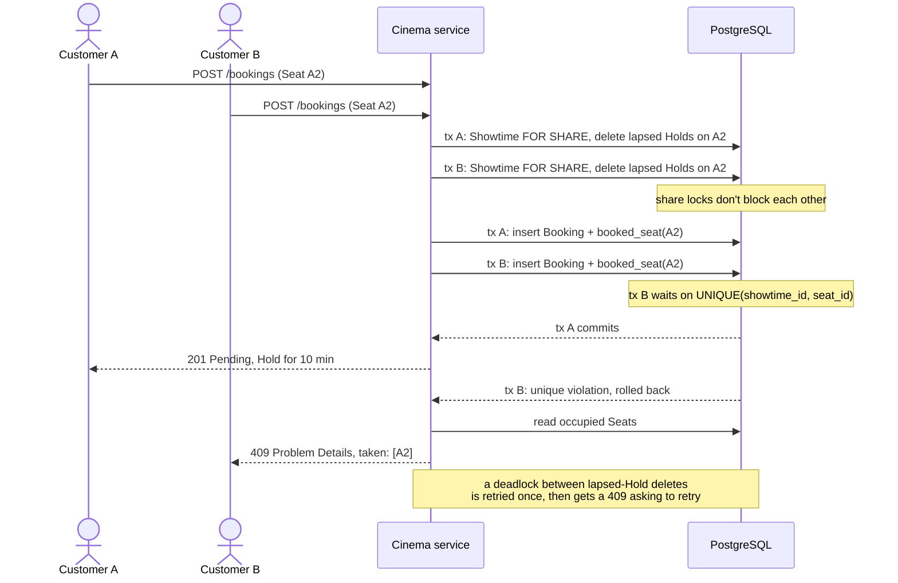

<div align="center">

# 🎬 Cinema Booking API

[](#-tech-stack)

[](https://github.com/14m6d4/se-phase-01/actions/workflows/ci.yml)
[](docs/openapi.json)
[](https://github.com/14m6d4/se-phase-01/pkgs/container/se-phase-01)
[](LICENSE)


</div>

A REST backend for a cinema chain. Admins run the catalogue of cinemas, auditoriums, movies and showtimes; customers hold seats and pay for them. It is the phase 1 project of the Software Architecture course at VNU University of Engineering and Technology (UET).

## 📑 Table of contents

- [Features](#-features)
- [Domain model](#-domain-model)
- [Booking lifecycle](#-booking-lifecycle)
- [Architecture](#-architecture)
- [Assignment requirements](#-assignment-requirements)
- [Tech stack](#-tech-stack)
- [Getting started](#-getting-started)
- [API overview](#-api-overview)
- [Testing](#-testing)
- [Performance](#-performance)
- [CI/CD](#-cicd)
- [Known issues](#-known-issues)
- [Documentation](#-documentation)
- [License](#-license)

## ✨ Features

**Catalogue management (Admin)**
- Cinemas and auditoriums. An auditorium's seat layout is generated from its size (up to 26 rows), and each row is Standard, VIP or Couple.
- Movies and showtimes. A showtime ends after the movie's length plus 15 minutes of cleaning, and two showtimes in the same auditorium can't overlap.
- Showtime cancellation with a reason (equipment failure, power outage, emergency, other). One transaction refunds the paid bookings and releases the unpaid ones.

**Booking (Customer)**
- Self-registration and JWT login.
- Showtimes filtered by date, cinema and movie, and a live seat map with availability and prices.
- 1 to 8 seats per booking, held for 10 minutes until payment (simulated).
- A database unique constraint stops a seat from being sold twice, including when many customers race for it.

**Platform**
- OpenAPI 3.1 documentation with Swagger UI.
- Every error in [RFC 9457](https://www.rfc-editor.org/rfc/rfc9457) Problem Details format.
- Versioned schema migrations with Flyway.
- Health and metrics endpoints through Spring Boot Actuator.
- A Docker image, published to GitHub Container Registry.

## 🎬 Domain model



The database enforces three rules on its own:

- `booked_seat` has `UNIQUE(showtime_id, seat_id)`, so a seat is booked at most once per showtime.
- A partial unique index allows one `PENDING` booking per customer.
- An exclusion constraint rejects overlapping showtimes in the same auditorium, ignoring cancelled ones.

[`GLOSSARY.md`](GLOSSARY.md) defines each term (Hold, Pending, Refunded and the rest).

## 🎫 Booking lifecycle



Each booked seat keeps the price it had when the booking was made, so later price changes don't affect it:

| Seat type | Price |
|---|---|
| Standard | base price |
| VIP | base price + 20,000 VND |
| Couple | 2 × base price + 10,000 VND |

A customer can have only one live pending booking at a time, a showtime can't be booked once it has started, and paying a confirmed booking again returns it unchanged. The [booking walkthrough](docs/booking-walkthrough.md) runs the whole lifecycle on a live service.

## 🧱 Architecture

The service is one deployable with a layered architecture, one package per layer under `vn.edu.uet.cinema`.



| Layer | Responsibility | Allowed dependencies |
|---|---|---|
| `api` | Maps HTTP to use cases, validates input, renders errors | `business`, Spring Web |
| `business` | Domain rules and use cases | JDK only |
| `persistence` | Implements the business repository interfaces with JPA | `business`, JPA |
| `config` | Security rules, bean wiring, OpenAPI | everything |

Design decisions:

- The business layer imports no Spring, JPA or web code. It owns the repository interfaces and the persistence layer implements them, so business rules can be read and unit tested on their own ([ADR 0001](docs/adr/0001-framework-free-business-layer.md)).
- `ArchitectureTest` (ArchUnit) fails the build when a layer imports a package it is not allowed to.
- Spring Security's filter chain validates the JWT before any controller runs. Every access rule is in `config/SecurityConfig.java`, and controllers have no auth code.
- The database settles seat contention. Concurrent bookings race on the `booked_seat` insert, the loser gets a `409`, and there are no application locks. A lapsed hold is deleted the next time someone books one of its seats ([ADR 0004](docs/adr/0004-seat-contention-via-unique-constraint-and-lazy-holds.md)).

When two Customers want the same Seat, the unique index decides who gets it:



## ✅ Assignment requirements

| Requirement | Where it is met |
|---|---|
| REST + JSON with POST, GET and DELETE | [API overview](#-api-overview) |
| OpenAPI / Swagger specification | springdoc, Swagger UI at `/swagger-ui.html`, exported as [`docs/openapi.json`](docs/openapi.json) |
| Layered architecture, business layer free of web and DB imports | `api` → `business` → `persistence`, enforced by an ArchUnit test ([ADR 0001](docs/adr/0001-framework-free-business-layer.md)) |
| Repository / data access layer with an ORM | Spring Data JPA (Hibernate) adapters implementing business-layer repository interfaces |
| Login, at least one authenticated GET and POST | JWT login; `GET /api/bookings`, `POST /api/bookings` and more |
| Authentication through framework middleware | Spring Security filter chain, access rules declared once in `SecurityConfig` |
| Docker | Multi-stage [`Dockerfile`](Dockerfile), [`docker-compose.yml`](docker-compose.yml), image published to GHCR |
| Load test on a Kaggle CPU notebook | [`loadtest/`](loadtest/README.md) with k6 ([ADR 0003](docs/adr/0003-load-test-on-kaggle-without-docker.md)), results in [`docs/loadtest-baseline.md`](docs/loadtest-baseline.md) |

## 🧰 Tech stack

| Area | Technology |
|---|---|
| Language & runtime | Java 21 |
| Framework | Spring Boot 4.1 (Web MVC, Validation, Actuator) |
| Security | Spring Security 7, OAuth2 Resource Server (HS256 JWT), BCrypt |
| Persistence | Spring Data JPA / Hibernate 7, PostgreSQL 17, Flyway |
| API documentation | springdoc-openapi, Swagger UI |
| Testing | JUnit 6, Testcontainers, ArchUnit |
| Build & delivery | Maven Wrapper, Docker, GitHub Actions, GHCR |
| Load testing | k6 |

## 🚀 Getting started

You need Docker with Docker Compose.

```bash
git clone https://github.com/14m6d4/se-phase-01.git
cd se-phase-01
cp .env.example .env          # set your own secrets in .env
docker compose up --build
```

The service is ready when the log shows `Started CinemaApplication`.

| URL | Purpose |
|---|---|
| http://localhost:8080/swagger-ui.html | Interactive API docs |
| http://localhost:8080/v3/api-docs | OpenAPI specification (JSON; `/v3/api-docs.yaml` for YAML) |
| http://localhost:8080/actuator/health | Health check |

The Admin account comes from `ADMIN_EMAIL` and `ADMIN_PASSWORD` at startup. Compose refuses to start if a required variable is missing, and both containers listen on `127.0.0.1` only.

The [development guide](docs/development.md) covers running without Compose, every environment variable, a `curl` login example and the project layout.

## 📡 API overview

Base path: `/api`. Swagger UI and [`docs/openapi.json`](docs/openapi.json) have the full request and response schemas.

| Resource | Endpoint | Access |
|---|---|---|
| **Auth** | `POST /auth/register` | Public |
| | `POST /auth/login` | Public |
| | `GET /me` | Authenticated |
| **Cinemas** | `GET /cinemas`, `GET /cinemas/{id}` | Public |
| | `POST /cinemas`, `PUT /cinemas/{id}`, `DELETE /cinemas/{id}` | Admin |
| **Auditoriums** | `GET /cinemas/{id}/auditoriums`, `GET /auditoriums/{id}` | Public |
| | `POST /cinemas/{id}/auditoriums`, `DELETE /auditoriums/{id}` | Admin |
| **Movies** | `GET /movies`, `GET /movies/{id}` | Public |
| | `POST /movies`, `PUT /movies/{id}`, `DELETE /movies/{id}` | Admin |
| **Showtimes** | `GET /showtimes?date=&cinemaId=&movieId=` | Public |
| | `GET /showtimes/{id}`, `GET /showtimes/{id}/seats` | Public |
| | `POST /showtimes`, `DELETE /showtimes/{id}` | Admin |
| | `POST /showtimes/{id}/cancellation` | Admin |
| **Bookings** | `GET /bookings`, `GET /bookings/{id}` | Customer |
| | `POST /bookings`, `DELETE /bookings/{id}` | Customer |
| | `POST /bookings/{id}/payment` | Customer |

A login returns a bearer token valid for one hour; send it as `Authorization: Bearer <token>`. Every error is `application/problem+json`:

| Status | Meaning |
|---|---|
| `400` | Invalid request body or parameters |
| `401` | Missing, invalid or expired token |
| `403` | Authenticated but lacking the required role |
| `404` | Resource not found (including another customer's booking) |
| `409` | Business rule violation, e.g. seat already taken, overlapping showtime, hold expired |

Money is an integer amount in VND. Timestamps are ISO-8601 with an offset. The service runs on `Asia/Ho_Chi_Minh`, and `?date=` covers that calendar day in Vietnam time.

## 🧪 Testing

```bash
./mvnw verify
```

Docker must be running, because the integration tests start a real PostgreSQL through Testcontainers. The suite has four kinds of test:

- Unit tests for the business layer, which need no Spring context.
- Integration tests for controllers and repositories against PostgreSQL.
- Architecture tests (ArchUnit) for the layer rules.
- Contract tests checking that the generated OpenAPI specification lists every operation, error response and security requirement.

## 📈 Performance

The accepted baseline ran [k6](https://k6.io/) v2.3.0 on a [Kaggle CPU notebook (version 6)](https://www.kaggle.com/code/tunichdi/se-phase-01-issue19-baseline/versions/6), with the service, PostgreSQL and k6 on the same machine, at `RATE=50` for `DURATION=60s`. [`docs/loadtest-baseline.md`](docs/loadtest-baseline.md) records the source snapshot, and the run's `results/env.txt` has the runtime details.

| Scenario | Workflow | Run-average RPS | p50 | p95 | p99 | Error rate |
|---|---|---:|---:|---:|---:|---:|
| smoke | read the signed-in Customer's account | 36.7 | 2.80 ms | 5.09 ms | 6.60 ms | 0% |
| browse | list showtimes → open seat map | 79.9 | 3.06 ms | 5.22 ms | 8.78 ms | 0% |
| book | hold seats → pay | 78.4 | 6.21 ms | 9.80 ms | 13.06 ms | 0% |
| contention | many customers race for the same 10 seats | 37.0 | 6.30 ms | 8.32 ms | 10.26 ms | 0% |

RPS averages the whole run, including setup and ramps, so it is not the service's maximum capacity. Under contention, exactly 10 bookings succeeded and the other 3,989 attempts got the expected `409`. A SQL check after the run found no seat sold twice. Compare another run only against its own `results/env.txt`.

[`loadtest/`](loadtest/README.md) has the scenarios, seed data and steps to reproduce the run.

## 🔄 CI/CD

GitHub Actions ([`ci.yml`](.github/workflows/ci.yml)) runs on pull requests and on pushes to `main`. A change that touches only `docs/`, Markdown files or `LICENSE` skips it.

1. The `verify` job runs the load-test helper checks and `./mvnw verify`.
2. On a push to `main`, the `image` job builds the Docker image and pushes it to `ghcr.io/14m6d4/se-phase-01`, tagged `latest` and with the commit SHA.

## 🐛 Known issues

Phase 1 leaves these problems for phase 2.

**Booking and concurrency**
- **Seat hoarding.** A Hold claims its Seats whether or not it is ever paid. Registration is open, with no email verification and no rate limit, so many accounts can keep a Showtime's Seats held without buying ([ADR 0004](docs/adr/0004-seat-contention-via-unique-constraint-and-lazy-holds.md)).
- **Lapsed Holds linger.** Expiry is lazy: a lapsed Hold stays in the database until someone books one of its Seats or its Customer books again. Nothing cleans up the rest.
- **No booking history.** Abandoned and Expired Bookings are deleted, so they cannot be analysed later.
- **Seat contention could be handled more cheaply.** A request for a Seat someone else holds runs a full transaction before it fails: it locks the Showtime row, deletes lapsed Holds, inserts the Booking, hits the unique constraint, rolls back, then reads the occupied Seats to build the `409`. When many Customers want the same Seats, most of that work is wasted, and a request that loses a deadlock twice gets a `409` asking it to retry. Phase 2 could try an availability check before the insert, pessimistic locking of Seat rows (`SELECT … FOR UPDATE`), optimistic locking with a version column, or a booking queue, keeping the unique constraint as the final guard ([ADR 0004](docs/adr/0004-seat-contention-via-unique-constraint-and-lazy-holds.md)).
- **Cancellation side effects.** Cancelling a Showtime briefly blocks new bookings of it, and a Cancelled Showtime with Refunded Bookings can never be deleted ([ADR 0005](docs/adr/0005-showtime-cancellation-in-one-adapter-transaction.md)).

**Security**
- **Tokens cannot be revoked.** JWTs are signed with one shared HS256 secret and stay valid for their full hour; there is no refresh token and no logout.
- **No rate limiting** on login, registration or booking, so passwords can be brute-forced and endpoints flooded.
- **One Admin.** The only Admin comes from environment variables. Nobody can add Admins or audit their actions, and rotating the password needs a restart.
- **No CORS configuration.** A browser frontend on another origin cannot call the API.

**API**
- **No pagination.** `GET /movies`, `GET /cinemas` and `GET /bookings` return every row.
- **Loose response types in the specification.** Success responses are documented as `*/*` instead of `application/json`.
- **API docs always public.** Swagger UI and `/v3/api-docs` are exposed in every environment.

**Operations and performance**
- **Single instance, manual hosting.** CI publishes an image but nothing deploys it.
- **Untuned defaults.** The connection pool keeps Hikari's default of 10 connections, and the JVM runs without flags.
- **Thin observability.** Actuator exposes health and metrics only; there is no tracing, structured logging or alerting.

**Codebase**
- **Two model sets.** Business models and JPA entities are separate, joined by hand-written mappers ([ADR 0001](docs/adr/0001-framework-free-business-layer.md)).
- **Rules kept in two places.** Delete guards and the Showtime overlap rule live in both the business layer and the database, and must be changed together ([ADR 0006](docs/adr/0006-delete-guards-in-business-and-database.md)).

## 📚 Documentation

| Document | What it covers |
|---|---|
| [`GLOSSARY.md`](GLOSSARY.md) | Domain terms: Cinema, Showtime, Booking, Hold, Refunded and the rest |
| [`docs/openapi.json`](docs/openapi.json) | OpenAPI 3.1 specification of every endpoint, request, response and error |
| [`docs/booking-walkthrough.md`](docs/booking-walkthrough.md) | Step-by-step booking demo in Swagger UI or with `curl` |
| [`docs/development.md`](docs/development.md) | Running without Compose, configuration, project layout |
| [`docs/adr/`](docs/adr/) | Architecture decisions and why they were made |
| [`docs/loadtest-baseline.md`](docs/loadtest-baseline.md) | Accepted Kaggle load-test results |

## 📄 License

Released under the [MIT License](LICENSE).
