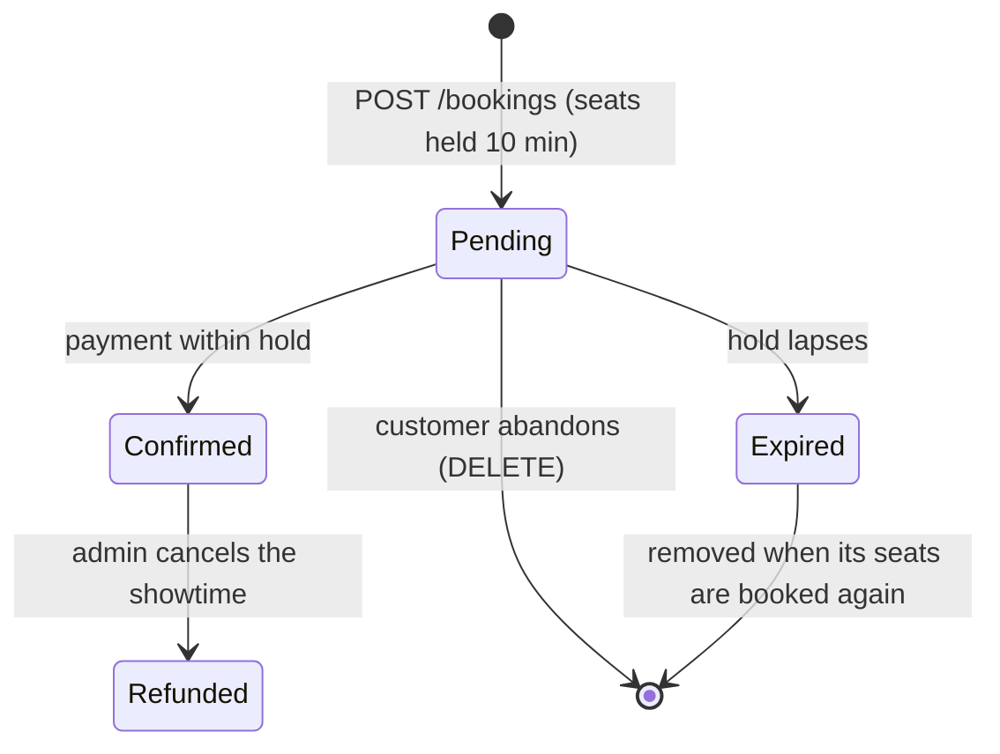

# Cinema Booking API

[](https://github.com/14m6d4/se-phase-01/actions/workflows/ci.yml)


[](LICENSE)

A REST backend for a cinema chain: admins run the catalogue (cinemas, auditoriums, movies, showtimes), customers hold seats and pay for them. Built as the phase 1 project of the Software Architecture course at VNU University of Engineering and Technology (UET).

## Table of contents

- [Features](#features)
- [Tech stack](#tech-stack)
- [Architecture](#architecture)
- [Getting started](#getting-started)
- [Configuration](#configuration)
- [API overview](#api-overview)
- [Booking lifecycle](#booking-lifecycle)
- [Testing](#testing)
- [Performance](#performance)
- [CI/CD](#cicd)
- [Project structure](#project-structure)
- [Scope and roadmap](#scope-and-roadmap)
- [License](#license)

## Features

**Catalogue management (admin)**
- Cinemas and auditoriums. Each auditorium gets a seat layout generated from its size (up to 26 rows), with rows marked as standard, VIP or couple seats.
- Movies and showtimes. The end of a showtime is computed from the movie's length plus 15 minutes of cleaning, and showtimes in the same auditorium can't overlap.
- Showtime cancellation with a reason (equipment failure, power outage, emergency, other). Paid bookings are refunded and unpaid ones are released, all in one transaction.

**Booking (customer)**
- Self-registration and JWT login.
- Browse showtimes by date, cinema and movie, and view a live seat map with availability and prices.
- Book 1 to 8 seats per booking. Seats are held for 10 minutes until payment (simulated).
- Concurrency-safe: a database unique constraint guarantees a seat is never sold twice, even under heavy contention.

**Platform**
- OpenAPI 3 documentation with Swagger UI.
- Consistent error responses in [RFC 9457](https://www.rfc-editor.org/rfc/rfc9457) Problem Details format.
- Versioned schema migrations with Flyway.
- Health and metrics endpoints via Spring Boot Actuator.
- Containerised with Docker; the image is published to GitHub Container Registry.

## Tech stack

| Area | Technology |
|---|---|
| Language & runtime | Java 21 |
| Framework | Spring Boot 4.1 (Web MVC, Validation, Actuator) |
| Security | Spring Security, OAuth2 Resource Server (HS256 JWT), BCrypt |
| Persistence | Spring Data JPA / Hibernate, PostgreSQL 17, Flyway |
| API documentation | springdoc-openapi, Swagger UI |
| Testing | JUnit 5, Testcontainers, ArchUnit |
| Build & delivery | Maven Wrapper, Docker, GitHub Actions, GHCR |
| Load testing | k6 |

## Architecture

The service is a single deployable organised as a **layered architecture**, one package per layer under `vn.edu.uet.cinema`.


| Layer | Responsibility | Allowed dependencies |
|---|---|---|
| `api` | Maps HTTP to use cases, validates input, renders errors | `business`, Spring Web |
| `business` | Domain rules and use cases | JDK only |
| `persistence` | Implements the business repository interfaces with JPA | `business`, JPA |
| `config` | Security rules, bean wiring, OpenAPI | everything |

Key design decisions:

- **Framework-free business layer.** The domain has no Spring, JPA or web imports. It owns the repository interfaces, and the persistence layer implements them (dependency inversion). This keeps business rules easy to read and to unit test.
- **Enforced boundaries.** `ArchitectureTest` (ArchUnit) fails the build when a layer rule is broken, so the architecture can't drift silently.
- **Authentication as middleware.** JWTs are validated by Spring Security's filter chain. All access rules live in `config/SecurityConfig.java`; controllers contain no auth logic.
- **Seat contention handled by the database.** Booked seats carry a `UNIQUE(showtime_id, seat_id)` constraint. Concurrent requests race on the insert and the loser gets a `409`, with no application-level locks. Expired holds are cleaned up lazily the next time someone books one of their seats.

## Getting started

### Prerequisites

- Docker with Docker Compose, or
- JDK 21 and PostgreSQL 17 to run the app outside a container.

### Quick start with Docker Compose

```bash
git clone https://github.com/14m6d4/se-phase-01.git
cd se-phase-01
cp .env.example .env          # set your own secrets in .env
docker compose up --build
```

| URL | Purpose |
|---|---|
| http://localhost:8080/swagger-ui.html | Interactive API docs |
| http://localhost:8080/v3/api-docs | OpenAPI specification (JSON) |
| http://localhost:8080/actuator/health | Health check |

An admin account is created on startup from `ADMIN_EMAIL` / `ADMIN_PASSWORD`. Compose refuses to start if a required variable is missing, and both services bind to `127.0.0.1` only.

To use the prebuilt image instead of building locally:

```bash
docker pull ghcr.io/14m6d4/se-phase-01:latest
```

### Running locally

Start only the database in Docker, then run the app with Maven:

```bash
docker compose up -d db
set -a; source .env; set +a   # export the variables from .env
./mvnw spring-boot:run
```

From an IDE, run `TestCinemaApplication` in `src/test`. It starts PostgreSQL in a container automatically. Set `JWT_SECRET` and `ADMIN_PASSWORD` in the run configuration.

## Configuration

All configuration is read from environment variables. Secrets have no defaults and must be provided.

| Variable | Required | Default | Description |
|---|:---:|---|---|
| `DB_URL` | | `jdbc:postgresql://localhost:5432/cinema` | JDBC URL |
| `DB_USERNAME` | | `cinema` | Database user |
| `DB_PASSWORD` | ✓ | | Database password |
| `JWT_SECRET` | ✓ | | HS256 signing key, at least 32 bytes (`openssl rand -base64 32`) |
| `ADMIN_EMAIL` | | `admin@cinema.local` | Admin account, created or updated at startup |
| `ADMIN_PASSWORD` | ✓ | | Admin password; change it and restart to rotate |

## API overview

Base path: `/api`. Full request and response schemas are in Swagger UI.

| Resource | Endpoint | Access |
|---|---|---|
| **Auth** | `POST /auth/register` | Public |
| | `POST /auth/login` | Public |
| | `GET /me` | Authenticated |
| **Cinemas** | `GET /cinemas`, `GET /cinemas/{id}` | Public |
| | `POST /cinemas`, `PUT /cinemas/{id}`, `DELETE /cinemas/{id}` | Admin |
| **Auditoriums** | `GET /cinemas/{id}/auditoriums`, `GET /auditoriums/{id}` | Public |
| | `POST /cinemas/{id}/auditoriums`, `DELETE /auditoriums/{id}` | Admin |
| **Movies** | `GET /movies`, `GET /movies/{id}` | Public |
| | `POST /movies`, `PUT /movies/{id}`, `DELETE /movies/{id}` | Admin |
| **Showtimes** | `GET /showtimes?date=&cinemaId=&movieId=` | Public |
| | `GET /showtimes/{id}`, `GET /showtimes/{id}/seats` | Public |
| | `POST /showtimes`, `DELETE /showtimes/{id}` | Admin |
| | `POST /showtimes/{id}/cancellation` | Admin |
| **Bookings** | `GET /bookings`, `GET /bookings/{id}` | Customer |
| | `POST /bookings`, `DELETE /bookings/{id}` | Customer |
| | `POST /bookings/{id}/payment` | Customer |

### Authentication

Log in to get a bearer token (valid for one hour), then send it in the `Authorization` header:

```bash
curl -X POST localhost:8080/api/auth/register -H 'Content-Type: application/json' \
  -d '{"email":"alice@example.com","password":"password123","fullName":"Alice"}'

TOKEN=$(curl -s -X POST localhost:8080/api/auth/login -H 'Content-Type: application/json' \
  -d '{"email":"alice@example.com","password":"password123"}' | jq -r .accessToken)

curl localhost:8080/api/me -H "Authorization: Bearer $TOKEN"
```

In Swagger UI, call `POST /api/auth/login`, click **Authorize** and paste the `accessToken`.

### Errors

Every error is returned as `application/problem+json`:

| Status | Meaning |
|---|---|
| `400` | Invalid request body or parameters |
| `401` | Missing, invalid or expired token |
| `403` | Authenticated but lacking the required role |
| `404` | Resource not found (including another customer's booking) |
| `409` | Business rule violation, e.g. seat already taken, overlapping showtime, hold expired |

### Conventions

- Money is an integer amount in VND.
- Timestamps are ISO-8601 with offset. The service runs on `Asia/Ho_Chi_Minh`, and `?date=` covers that calendar day in Vietnam time.

## Booking lifecycle



Pricing is copied into the booking when it is created, so later price changes don't affect it:

| Seat type | Price |
|---|---|
| Standard | base price |
| VIP | base price + 20,000 VND |
| Couple | 2 × base price + 10,000 VND |

Other rules: a customer can have only one live pending booking at a time, a showtime can't be booked once it has started, and paying an already confirmed booking is idempotent.

## Testing

```bash
./mvnw verify
```

Docker must be running: integration tests start a real PostgreSQL through Testcontainers. The suite covers:

- **Unit tests** for the business layer, which needs no Spring context.
- **Integration tests** for controllers and repositories against PostgreSQL.
- **Architecture tests** (ArchUnit) for the layer rules.

## Performance

Baseline load test with [k6](https://k6.io/) on a Kaggle CPU instance (4 vCPU, 31 GiB RAM), with the service, PostgreSQL and k6 sharing the machine. Load was 50 iterations/s held for 60 s.

| Scenario | Workflow | Throughput | p50 | p95 | p99 | Error rate |
|---|---|---:|---:|---:|---:|---:|
| browse | list showtimes → open seat map | 119.8 req/s | 2.86 ms | 6.85 ms | 11.10 ms | 0% |
| book | hold seats → pay | 78.2 req/s | 8.49 ms | 12.58 ms | 15.27 ms | 0% |
| contention | many customers race for the same 10 seats | 36.9 req/s | 6.51 ms | 8.25 ms | 9.47 ms | 0% |

Under contention, exactly 10 bookings succeeded and every other attempt received a `409`. A SQL check after the run confirmed no seat was sold twice.

Scenarios, seed data and instructions for reproducing the run are in [`loadtest/`](loadtest/README.md).

## CI/CD

GitHub Actions ([`ci.yml`](.github/workflows/ci.yml)) runs on every pull request and every push to `main`:

1. Runs the load-test helper checks and `./mvnw verify` (unit, integration and architecture tests).
2. On `main`, builds the Docker image and publishes it to `ghcr.io/14m6d4/se-phase-01:latest`.

## Project structure

```
.
├── src/
│   ├── main/
│   │   ├── java/vn/edu/uet/cinema/
│   │   │   ├── api/            # REST controllers, DTOs, exception → ProblemDetail
│   │   │   ├── business/       # domain models, services, repository interfaces
│   │   │   ├── persistence/    # JPA entities, Spring Data repositories, adapters
│   │   │   └── config/         # security, bean wiring, OpenAPI
│   │   └── resources/
│   │       └── db/migration/   # Flyway migrations
│   └── test/                   # unit, integration and architecture tests
├── loadtest/                   # k6 scenarios, seed data, Kaggle notebook
├── .github/workflows/          # CI pipeline
├── Dockerfile                  # multi-stage build
└── docker-compose.yml          # app + PostgreSQL
```

## Scope and roadmap

Phase 1 deliberately leaves out real payment processing, promotions, tickets and check-in, customer-initiated refunds, pagination, refresh tokens and email verification. These are candidates for later phases.

## License

Released under the [MIT License](LICENSE).
