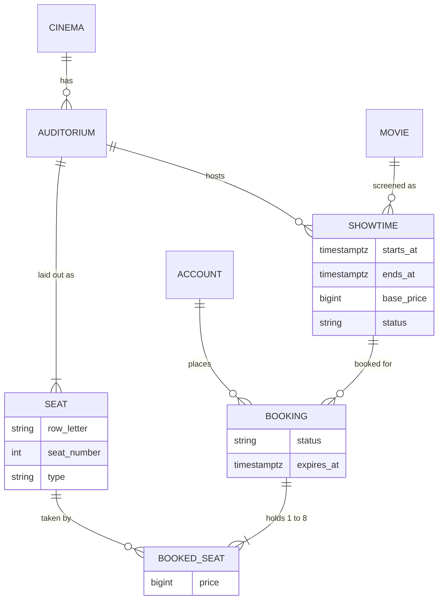
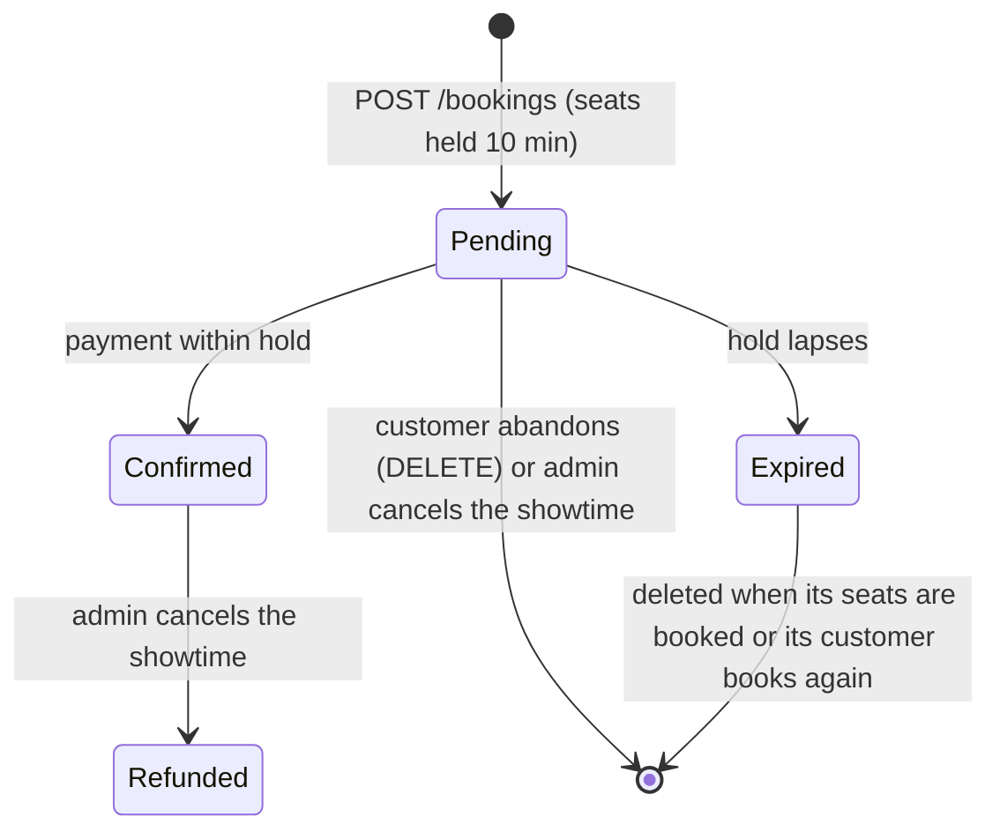
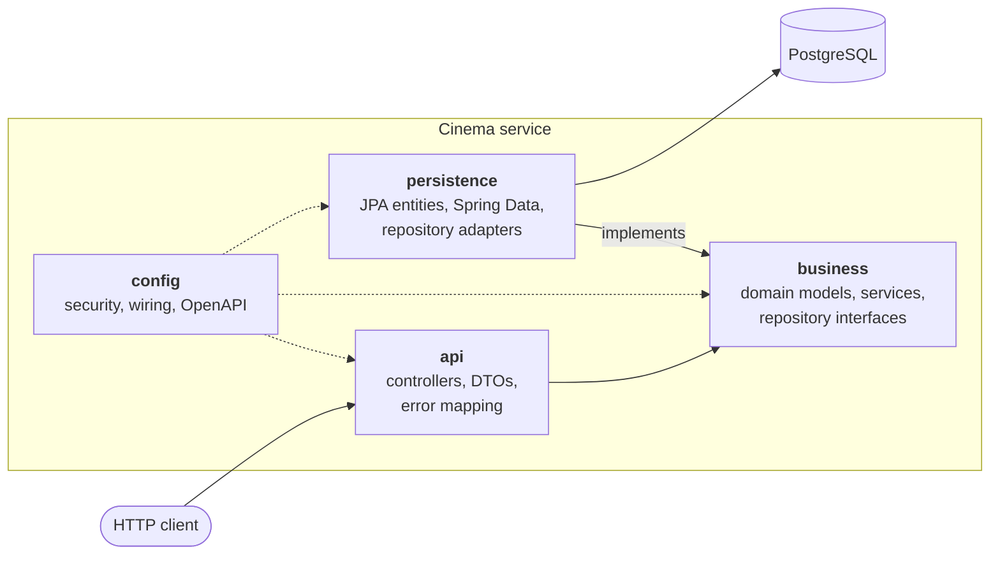
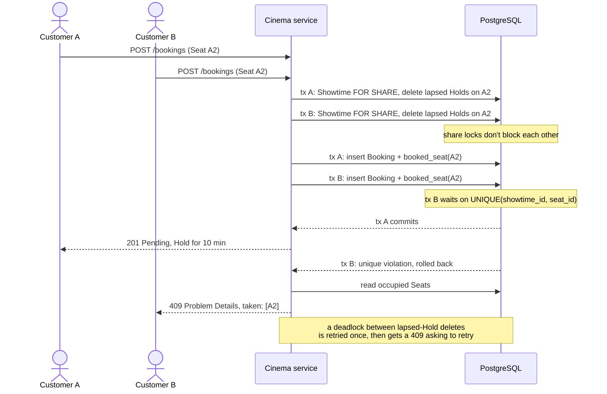

<div align="center">

# Cinema Booking API

[English](README.md) | Tiếng Việt

[](#công-nghệ)

[](https://github.com/14m6d4/se-phase-01/actions/workflows/ci.yml)
[](docs/openapi.json)
[](https://github.com/14m6d4/se-phase-01/pkgs/container/se-phase-01)
[](LICENSE)


Backend REST cho một chuỗi rạp chiếu phim. Admin quản lý danh mục rạp, phòng chiếu, phim và suất chiếu; khách hàng giữ ghế rồi thanh toán. Đây là đồ án phase 1 của học phần Kiến trúc phần mềm tại Trường Đại học Công nghệ, ĐHQGHN (UET).

</div>

## Mục lục

- [Tính năng](#tính-năng)
- [Mô hình miền](#mô-hình-miền)
- [Vòng đời đơn đặt vé](#vòng-đời-đơn-đặt-vé)
- [Kiến trúc](#kiến-trúc)
- [Yêu cầu của bài tập](#yêu-cầu-của-bài-tập)
- [Công nghệ](#công-nghệ)
- [Bắt đầu](#bắt-đầu)
- [Tổng quan API](#tổng-quan-api)
- [Kiểm thử](#kiểm-thử)
- [Hiệu năng](#hiệu-năng)
- [CI/CD](#cicd)
- [Vấn đề đã biết](#vấn-đề-đã-biết)
- [Tài liệu](#tài-liệu)
- [Giấy phép](#giấy-phép)

## Tính năng

**Quản lý danh mục (Admin)**
- Rạp và phòng chiếu. Sơ đồ ghế của phòng chiếu được sinh ra từ kích thước phòng (tối đa 26 hàng), mỗi hàng là Standard, VIP hoặc Couple.
- Phim và suất chiếu. Một suất chiếu kết thúc sau thời lượng phim cộng 15 phút dọn phòng, và hai suất chiếu trong cùng một phòng không được chồng giờ.
- Hủy suất chiếu kèm lý do (hỏng thiết bị, mất điện, sự cố khẩn cấp, lý do khác). Một transaction hoàn tiền cho các đơn đã thanh toán và trả ghế của các đơn chưa thanh toán.

**Đặt vé (khách hàng)**
- Tự đăng ký tài khoản và đăng nhập bằng JWT.
- Lọc suất chiếu theo ngày, rạp và phim; sơ đồ ghế hiển thị tình trạng và giá theo thời gian thực.
- Mỗi đơn đặt vé có từ 1 đến 8 ghế, được giữ trong 10 phút để chờ thanh toán (thanh toán giả lập).
- Một unique constraint trong database ngăn một ghế bị bán hai lần, kể cả khi nhiều khách hàng tranh nhau cùng lúc.

**Nền tảng**
- Tài liệu OpenAPI 3.1 kèm Swagger UI.
- Mọi lỗi đều trả về theo định dạng Problem Details của [RFC 9457](https://www.rfc-editor.org/rfc/rfc9457).
- Migration schema có đánh phiên bản bằng Flyway.
- Endpoint health và metrics qua Spring Boot Actuator.
- Docker image được publish lên GitHub Container Registry.

## Mô hình miền



Ba quy tắc sau do chính database kiểm tra:

- `booked_seat` có `UNIQUE(showtime_id, seat_id)`, nên trong một suất chiếu mỗi ghế chỉ được đặt tối đa một lần.
- Một partial unique index chỉ cho phép mỗi khách hàng có một đơn `PENDING`.
- Một exclusion constraint chặn các suất chiếu chồng giờ trong cùng một phòng chiếu, không tính các suất đã bị hủy.

[`GLOSSARY.vi.md`](GLOSSARY.vi.md) định nghĩa từng thuật ngữ (Hold, Pending, Refunded và các thuật ngữ khác).

## Vòng đời đơn đặt vé



Mỗi ghế đã đặt giữ nguyên giá tại thời điểm đặt, nên việc đổi giá về sau không ảnh hưởng tới nó:

| Loại ghế | Giá |
|---|---|
| Standard | giá gốc |
| VIP | giá gốc + 20,000 VND |
| Couple | 2 × giá gốc + 10,000 VND |

Tại mỗi thời điểm, một khách hàng chỉ có một đơn Pending còn hiệu lực. Suất chiếu đã bắt đầu thì không đặt được nữa, và thanh toán lại một đơn đã Confirmed chỉ trả về đúng đơn đó, không thay đổi gì. [Hướng dẫn đặt vé](docs/booking-walkthrough.vi.md) chạy toàn bộ vòng đời này trên một service đang chạy.

## Kiến trúc

Service là một deployable duy nhất theo kiến trúc phân lớp, mỗi layer là một package dưới `vn.edu.uet.cinema`.



| Layer | Trách nhiệm | Được phụ thuộc vào |
|---|---|---|
| `api` | Ánh xạ HTTP sang use case, kiểm tra đầu vào, trả lỗi | `business`, Spring Web |
| `business` | Quy tắc nghiệp vụ và use case | Chỉ JDK |
| `persistence` | Hiện thực các repository interface của business bằng JPA | `business`, JPA |
| `config` | Quy tắc bảo mật, wiring bean, OpenAPI | Tất cả |

Các quyết định thiết kế:

- Business layer không import code nào của Spring, JPA hay web. Layer này sở hữu các repository interface và persistence layer hiện thực chúng, nhờ vậy quy tắc nghiệp vụ có thể đọc và unit test độc lập ([ADR 0001](docs/adr/0001-framework-free-business-layer.vi.md)).
- `ArchitectureTest` (ArchUnit) làm build thất bại khi một layer import package mà nó không được phép dùng.
- Filter chain của Spring Security kiểm tra JWT trước khi request tới controller. Mọi quy tắc truy cập nằm trong `config/SecurityConfig.java`, controller không chứa code xác thực.
- Database quyết định khi nhiều người tranh cùng một ghế. Các lượt đặt đồng thời race nhau ở lệnh insert vào `booked_seat`, bên thua nhận `409`, và ứng dụng không dùng lock nào. Một Hold đã hết hạn bị xóa vào lần tiếp theo có người đặt một trong các ghế của nó ([ADR 0004](docs/adr/0004-seat-contention-via-unique-constraint-and-lazy-holds.vi.md)).

Khi hai khách hàng cùng muốn một ghế, unique index quyết định ai được ghế:



## Yêu cầu của bài tập

| Yêu cầu | Đáp ứng ở đâu |
|---|---|
| REST + JSON với POST, GET và DELETE | [Tổng quan API](#tổng-quan-api) |
| Đặc tả OpenAPI / Swagger | springdoc, Swagger UI tại `/swagger-ui.html`, xuất ra [`docs/openapi.json`](docs/openapi.json) |
| Kiến trúc phân lớp, business layer không import web hay DB | `api` → `business` → `persistence`, được kiểm tra bằng ArchUnit test ([ADR 0001](docs/adr/0001-framework-free-business-layer.vi.md)) |
| Repository / data access layer dùng ORM | Các adapter Spring Data JPA (Hibernate) hiện thực repository interface của business layer |
| Đăng nhập, có ít nhất một GET và một POST cần xác thực | Đăng nhập bằng JWT; `GET /api/bookings`, `POST /api/bookings` và các endpoint khác |
| Xác thực qua middleware của framework | Filter chain của Spring Security, quy tắc truy cập khai báo một lần trong `SecurityConfig` |
| Docker | [`Dockerfile`](Dockerfile) multi-stage, [`docker-compose.yml`](docker-compose.yml), image publish lên GHCR |
| Load test trên Kaggle CPU notebook | [`loadtest/`](loadtest/README.vi.md) với k6 ([ADR 0003](docs/adr/0003-load-test-on-kaggle-without-docker.vi.md)), kết quả trong [`docs/loadtest-baseline.vi.md`](docs/loadtest-baseline.vi.md) |

## Công nghệ

| Mảng | Công nghệ |
|---|---|
| Ngôn ngữ và runtime | Java 21 |
| Framework | Spring Boot 4.1 (Web MVC, Validation, Actuator) |
| Bảo mật | Spring Security 7, OAuth2 Resource Server (HS256 JWT), BCrypt |
| Persistence | Spring Data JPA / Hibernate 7, PostgreSQL 17, Flyway |
| Tài liệu API | springdoc-openapi, Swagger UI |
| Kiểm thử | JUnit 6, Testcontainers, ArchUnit |
| Build và phân phối | Maven Wrapper, Docker, GitHub Actions, GHCR |
| Load test | k6 |

## Bắt đầu

Bạn cần Docker có Docker Compose.

```bash
git clone https://github.com/14m6d4/se-phase-01.git
cd se-phase-01
cp .env.example .env          # đặt secret của bạn trong .env
docker compose up --build
```

Service sẵn sàng khi log hiện `Started CinemaApplication`.

| URL | Mục đích |
|---|---|
| http://localhost:8080/swagger-ui.html | Tài liệu API tương tác |
| http://localhost:8080/v3/api-docs | Đặc tả OpenAPI (JSON; `/v3/api-docs.yaml` cho YAML) |
| http://localhost:8080/actuator/health | Health check |

Tài khoản Admin được tạo từ `ADMIN_EMAIL` và `ADMIN_PASSWORD` khi khởi động. Compose không chạy nếu thiếu biến bắt buộc, và cả hai container chỉ lắng nghe trên `127.0.0.1`.

[Hướng dẫn phát triển](docs/development.vi.md) trình bày cách chạy không cần Compose, toàn bộ biến môi trường, ví dụ đăng nhập bằng `curl` và cấu trúc dự án.

## Tổng quan API

Base path: `/api`. Swagger UI và [`docs/openapi.json`](docs/openapi.json) có đầy đủ schema của request và response.

| Tài nguyên | Endpoint | Quyền truy cập |
|---|---|---|
| **Auth** | `POST /auth/register` | Public |
| | `POST /auth/login` | Public |
| | `GET /me` | Đã đăng nhập |
| **Cinemas** | `GET /cinemas`, `GET /cinemas/{id}` | Public |
| | `POST /cinemas`, `PUT /cinemas/{id}`, `DELETE /cinemas/{id}` | Admin |
| **Auditoriums** | `GET /cinemas/{id}/auditoriums`, `GET /auditoriums/{id}` | Public |
| | `POST /cinemas/{id}/auditoriums`, `DELETE /auditoriums/{id}` | Admin |
| **Movies** | `GET /movies`, `GET /movies/{id}` | Public |
| | `POST /movies`, `PUT /movies/{id}`, `DELETE /movies/{id}` | Admin |
| **Showtimes** | `GET /showtimes?date=&cinemaId=&movieId=` | Public |
| | `GET /showtimes/{id}`, `GET /showtimes/{id}/seats` | Public |
| | `POST /showtimes`, `DELETE /showtimes/{id}` | Admin |
| | `POST /showtimes/{id}/cancellation` | Admin |
| **Bookings** | `GET /bookings`, `GET /bookings/{id}` | Khách hàng |
| | `POST /bookings`, `DELETE /bookings/{id}` | Khách hàng |
| | `POST /bookings/{id}/payment` | Khách hàng |

Đăng nhập trả về một bearer token có hiệu lực một giờ; gửi token qua header `Authorization: Bearer <token>`. Mọi lỗi đều có dạng `application/problem+json`:

| Status | Ý nghĩa |
|---|---|
| `400` | Body hoặc tham số của request không hợp lệ |
| `401` | Thiếu token, token sai hoặc đã hết hạn |
| `403` | Đã xác thực nhưng không có role cần thiết |
| `404` | Không tìm thấy tài nguyên (kể cả đơn đặt vé của khách hàng khác) |
| `409` | Vi phạm quy tắc nghiệp vụ, ví dụ ghế đã có người lấy, suất chiếu chồng giờ, Hold đã hết hạn |

Tiền là số nguyên tính bằng VND. Thời gian theo ISO-8601 có offset. Service chạy theo múi giờ `Asia/Ho_Chi_Minh`, và `?date=` lấy trọn ngày đó theo giờ Việt Nam.

## Kiểm thử

```bash
./mvnw verify
```

Docker phải đang chạy, vì integration test khởi động một PostgreSQL thật qua Testcontainers. Bộ test có bốn loại:

- Unit test cho business layer, không cần Spring context.
- Integration test cho controller và repository, chạy trên PostgreSQL.
- Architecture test (ArchUnit) cho các quy tắc giữa các layer.
- Contract test, kiểm tra đặc tả OpenAPI được sinh ra có đủ mọi operation, response lỗi và yêu cầu bảo mật.

## Hiệu năng

Capacity baseline hiện tại dùng [k6](https://k6.io/) v2.3.0 trên hai Kaggle CPU notebook công khai, chạy độc lập với nhau. Trong mỗi notebook, service, PostgreSQL và k6 dùng chung máy: k6 được ghim vào một CPU, service và PostgreSQL chạy trên CPU 1-3. [`docs/loadtest-baseline.vi.md`](docs/loadtest-baseline.vi.md) ghi lại snapshot mã nguồn, kết quả từng step, telemetry và phần so sánh. Tốc độ tính bằng it/s, tức số workflow hoàn tất mỗi giây; browse và book gửi hai HTTP request cho mỗi workflow.


| Scenario | Step cao nhất còn giữ được, it/s (Run 1 / Run 2) | Tầng quá tải đầu tiên |
|---|---:|---|
| account | 1,200 / 1,200 | Hàng đợi request trong ứng dụng (thread Tomcat, Hikari pending) |
| browse | 400 / 400 | Chưa kết luận được: k6 dùng 92-93% core duy nhất của nó |
| book | 50 / none | Chưa xác định; iowait cao là manh mối đầu tiên |
| contention | 200 / 400 | Tranh chấp ở PostgreSQL và ứng dụng quanh truy vấn trạng thái ghế |
| race | 200 / 300 | Tranh chấp ở PostgreSQL và ứng dụng quanh truy vấn trạng thái ghế |

Đây là các step cao nhất trong cấu hình còn giữ được theo quy tắc của baseline, không phải năng lực tối đa của service. Cả 21 step contention và race đều qua kiểm tra SQL: không ghế nào bị đặt hai lần, và số `201` với `409` khớp nhau. Khi có tranh chấp, truy vấn đọc các ghế đã có người lấy của một suất chiếu (`booking` join với `booked_seat`) chiếm 51-149 s thời gian database mỗi step, nên đây là mục tiêu tối ưu đầu tiên của phase 2.

[`loadtest/`](loadtest/README.vi.md) có các scenario, dữ liệu seed và cách chạy lại.

## CI/CD

GitHub Actions ([`ci.yml`](.github/workflows/ci.yml)) chạy với mỗi pull request và mỗi lần push lên `main`. Thay đổi chỉ chạm vào `docs/`, file Markdown hoặc `LICENSE` thì CI bỏ qua.

1. Job `verify` chạy test của các helper load test và `./mvnw verify`.
2. Khi push lên `main`, job `image` build Docker image rồi push lên `ghcr.io/14m6d4/se-phase-01`, gắn tag `latest` và commit SHA.

## Vấn đề đã biết

Phase 1 cố ý chưa làm những việc dưới đây; phase 2 sẽ chạy lại [load test](docs/loadtest-baseline.vi.md) để đo tác động của từng thay đổi.

| Vấn đề | Mức độ | Tác động | Hướng xử lý ở phase 2 |
|---|---|---|---|
| Giữ ghế mà không mua | Cao | Nhiều tài khoản miễn phí có thể cùng nhau giữ ghế của một suất chiếu mà không thanh toán | Giới hạn số lần giữ ghế, xác minh email trước khi đặt vé |
| Thanh toán giả lập | Cao | Chưa có cổng thanh toán: thanh toán không thể thất bại và hoàn tiền không chuyển tiền thật | Tích hợp cổng thanh toán; thu tiền và hoàn tiền phải idempotent |
| Không thu hồi được token | Cao | Token bị lộ vẫn dùng được hết một giờ; không có logout | Access token thời hạn ngắn kèm refresh token thu hồi được |
| Không có rate limit | Cao | Mật khẩu có thể bị brute-force và các endpoint có thể bị làm ngập | Giới hạn theo IP và theo tài khoản |
| Chỉ có một Admin | Trung bình | Admin lấy từ biến môi trường; không có audit; đổi mật khẩu phải khởi động lại | Quản lý Admin và audit log |
| Tranh chấp ghế chỉ do database xử lý | Trung bình | Khi có tranh chấp, service giữ được 200-400 it/s, và phần lớn thời gian database dành cho việc đọc ghế nào đã có người lấy | Đọc trạng thái ghế rẻ hơn, sau đó so sánh pessimistic locking, optimistic locking và hàng đợi đặt vé ([ADR 0004](docs/adr/0004-seat-contention-via-unique-constraint-and-lazy-holds.vi.md)) |
| Sơ đồ ghế bị đọc lại ở mỗi request | Trung bình | Truy vấn tốn nhất của browse, dù sơ đồ ghế không bao giờ đổi | Cache sơ đồ ghế theo từng phòng chiếu |
| Chỉ một instance | Trung bình | Không có failover hay horizontal scaling; CI publish image nhưng chưa có gì deploy nó | Nhiều instance đứng sau một load balancer |
| Observability còn mỏng | Thấp | Chỉ có health và metrics | Tracing, structured log, cảnh báo |
| Không phân trang | Thấp | `GET /movies`, `/cinemas` và `/bookings` trả về mọi dòng | Tham số `page` và `size` |

## Tài liệu

| Tài liệu | Nội dung |
|---|---|
| [`GLOSSARY.vi.md`](GLOSSARY.vi.md) | Thuật ngữ nghiệp vụ: rạp, suất chiếu, đơn đặt vé, Hold, Refunded và các thuật ngữ khác |
| [`docs/openapi.json`](docs/openapi.json) | Đặc tả OpenAPI 3.1 của mọi endpoint, request, response và lỗi |
| [`docs/booking-walkthrough.vi.md`](docs/booking-walkthrough.vi.md) | Demo đặt vé từng bước trong Swagger UI hoặc bằng `curl` |
| [`docs/development.vi.md`](docs/development.vi.md) | Chạy không cần Compose, cấu hình, cấu trúc dự án |
| [`docs/adr/`](docs/adr/) | Các quyết định kiến trúc và lý do (mỗi ADR có bản `.vi.md`) |
| [`docs/loadtest-baseline.vi.md`](docs/loadtest-baseline.vi.md) | Kết quả load test trên Kaggle đã được chấp nhận |
| [`loadtest/README.vi.md`](loadtest/README.vi.md) | Các scenario load test, dữ liệu seed, cách chạy trên máy hoặc trên Kaggle |

## Giấy phép

Phát hành theo [giấy phép MIT](LICENSE).
