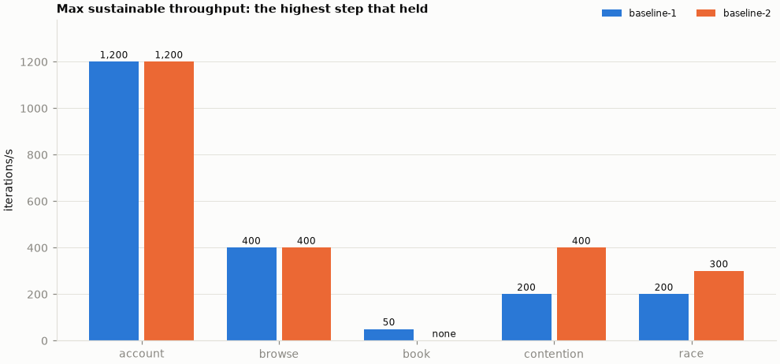
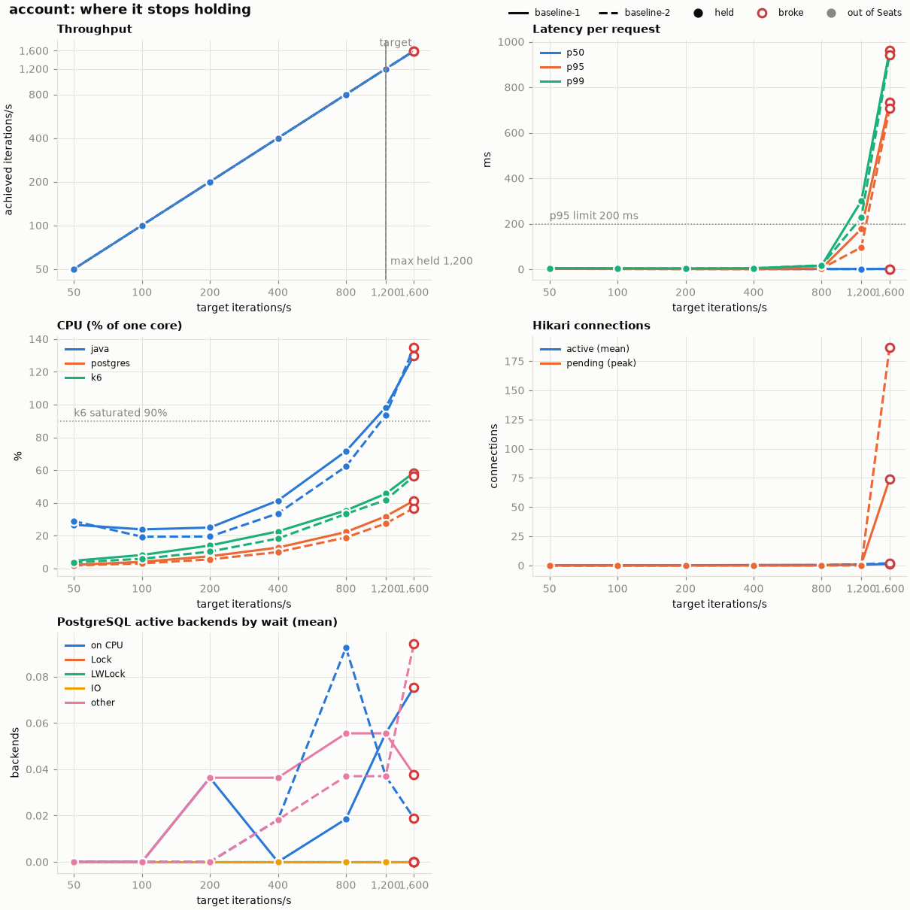
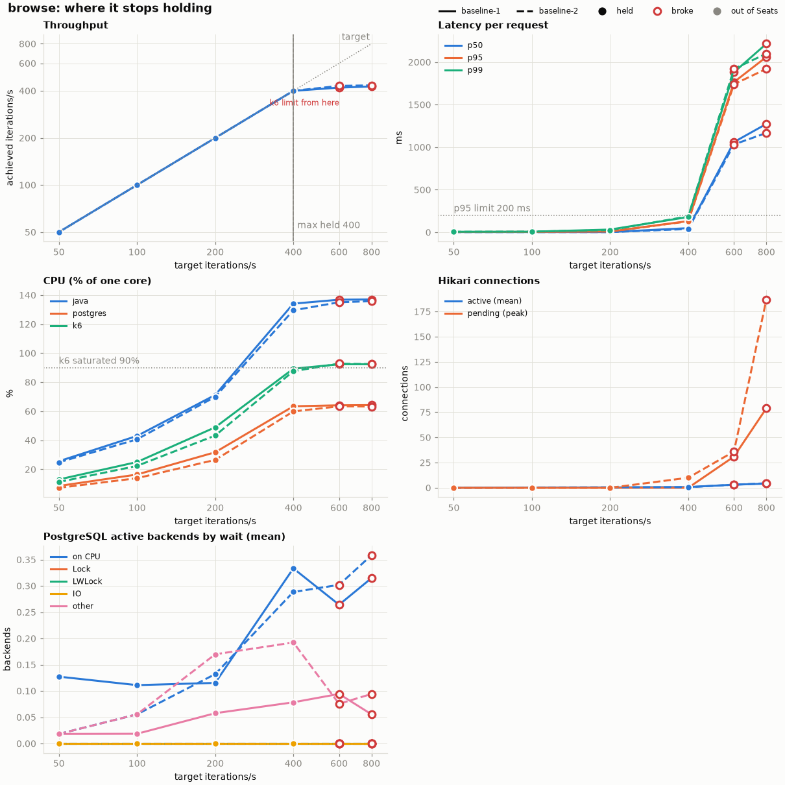
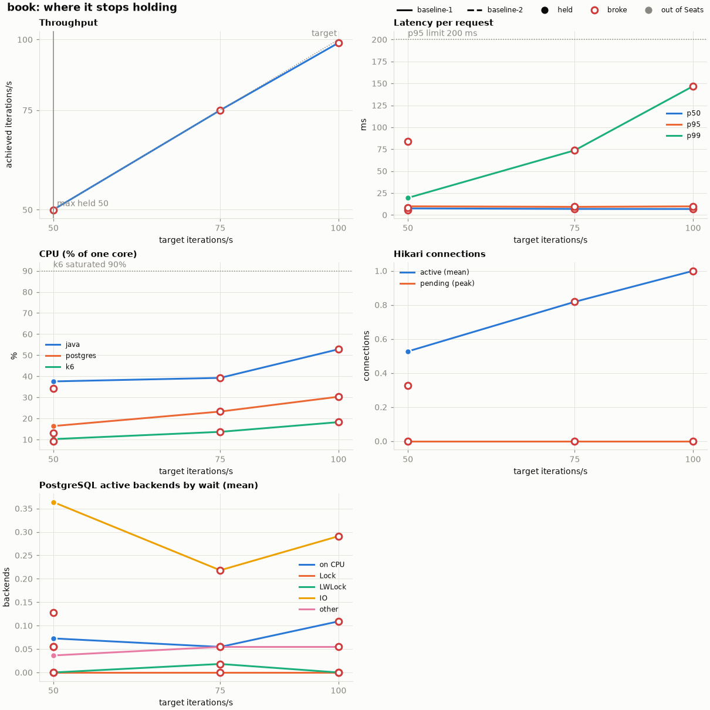
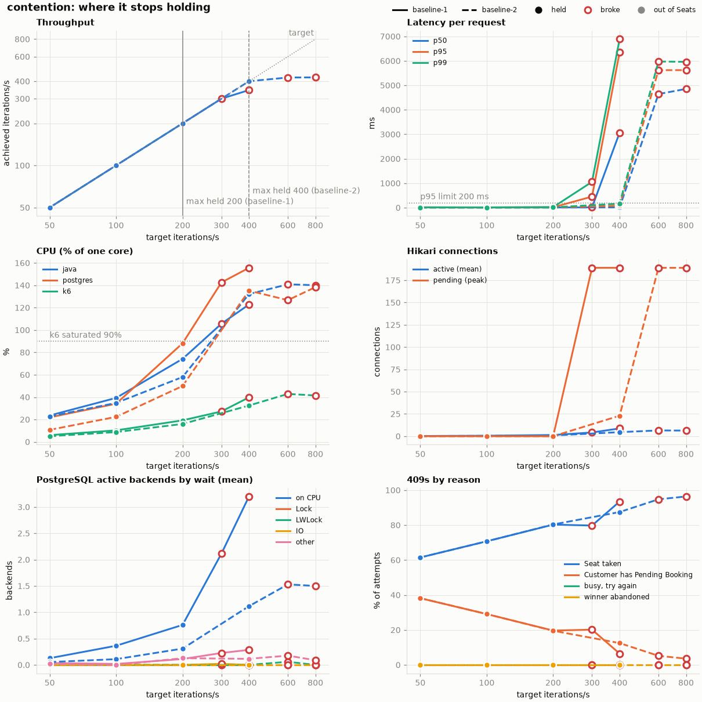
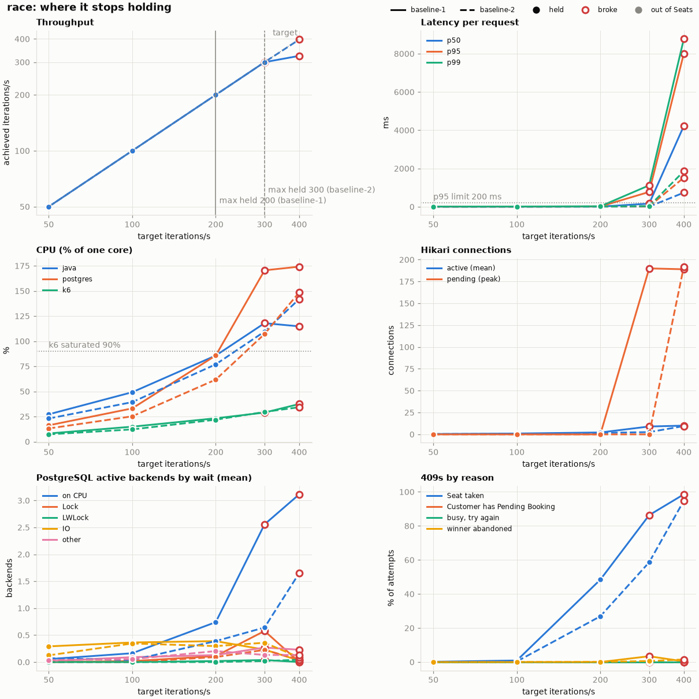

# Kaggle load-test capacity baseline

Two public Kaggle CPU notebooks ran the same code (`4d40ac3`) with the same settings on 2026-10-29, and both finished all five scenarios: [Run 1, notebook version 8](https://www.kaggle.com/code/tunichdi/se-phase-01-issue19-baseline/versions/8) and [Run 2, notebook version 1](https://www.kaggle.com/code/tunichdi/se-phase-01-capacity-baseline-2/versions/1). Raw outputs stay on Kaggle, not in Git.

## Summary



| Scenario | Workflow | Highest held, it/s (Run 1 / Run 2) | First broken, it/s (Run 1 / Run 2) | Gave out first |
|---|---|---:|---:|---|
| account | Read the signed-in Customer's Account | 1,200 / 1,200 | 1,600 / 1,600 | Application request queue (Tomcat threads, Hikari pending) |
| browse | List Showtimes and open a seat map | 400 / 400 | 600 / 600 | Inconclusive: k6 at 92-93% of its one core |
| book | Hold an unused Seat and pay | 50 / none | 75 / 50 | Not identified: only dropped iterations, no tier saturated; iowait (6-12%) is the first lead |
| contention | Many Customers try to book the same 10 Seats, which are already on Hold | 200 / 400 | 300 / 600 | PostgreSQL and app contention on the seat-status query |
| race | Customers race for the same free Seats, and each winner abandons | 200 / 300 | 300 / 400 | PostgreSQL and app contention on the seat-status query, plus lock waits in Run 1 |

The highest held step is the scenario's max sustainable throughput in that run; `none` means no step held. All 21 contention and race steps passed SQL verification: no Seat was booked twice, and the 201 and 409 counts add up.

## How to read the results

- Each scenario warms up at 50 it/s without measuring, then runs 60-second steps at 50, 100, 200 and so on. After the first broken step it runs one more step halfway between the last held rate and the broken one. [ADR 0007](adr/0007-capacity-baseline-by-stepped-arrival-rate-runs.md) explains why.
- A step `broke` if any of these is true, and `held` otherwise:
  - p95 latency above 200 ms
  - more than 1% unexpected request errors
  - fewer than 99% of checks passed
  - any dropped iteration
  - achieved rate below 95% of the target
- `exhausted` means book ran out of seeded Seats, which does not count as a break. Neither run exhausted the seed.
- it/s is completed workflow iterations per second. RPS is HTTP requests per second; browse and book make two requests per iteration.
- Step tables are sorted by rate, so a halfway step such as book's 75 it/s comes before the higher step that triggered it.
- Telemetry is averaged over the step unless marked as a peak. CPU is a percentage of one core, so 135% is 1.35 cores. PostgreSQL waits are the average number of active backends in each wait type.
- Contention and race steps end with an SQL check: created bookings minus abandoned ones equal the booked-seat rows, no Seat appears twice, and every 409 has a known reason (Seat taken, Customer already has a Pending Booking, busy, or Seat free again).

## Environment

| Item | Both runs |
|---|---|
| Source commit | `4d40ac3add0fa3f8d26e8a2ac8cc4ef5fa138e45` |
| Hardware | 4 CPUs, Intel Xeon @ 2.20 GHz, 31 GiB RAM |
| CPU affinity | k6 and the notebook on CPU 0; service and PostgreSQL on CPUs 1-3 |
| Runtime | OpenJDK 21.0.12.1 (G1 GC, no JVM flags), PostgreSQL 14.24, Hikari pool of 10 |
| Load generator | k6 v2.3.0 |

<details>
<summary>Source hashes, dataset and notebook metadata</summary>

| Item | Run 1 | Run 2 |
|---|---|---|
| Kernel | `tunichdi/se-phase-01-issue19-baseline`, version 8 | `tunichdi/se-phase-01-capacity-baseline-2`, version 1 |
| Report timestamp | 2026-10-29 07:38:05 UTC | 2026-10-29 07:56:03 UTC |
| Source bundle (expanded tree SHA-256) | `bca958516e03508b624dabd5a4fefd84fccd66c8e5f5e51c4078d0de228d16e8` | `bca958516e03508b624dabd5a4fefd84fccd66c8e5f5e51c4078d0de228d16e8` |
| Staged notebook SHA-256 | `22912b24a77df0d6762c1e2c9b7d7e9e82f07175e6d26ddfad3e59784841e9cf` | `22912b24a77df0d6762c1e2c9b7d7e9e82f07175e6d26ddfad3e59784841e9cf` |
| Source dataset | `tunichdi/se-phase-01-issue19-source`, private version 8 | `tunichdi/se-phase-01-issue19-source`, private version 8 |
| Kernel metadata | Public CPU notebook; GPU false; TPU false; internet true | Public CPU notebook; GPU false; TPU false; internet true |
| Parameters | `SCENARIO=all`, `START_RATE=50`, `MAX_RATE=6400`, `DURATION=60s`, `CODE_BUNDLE=auto` | Same |

The source dataset is private, but both notebooks are public, so their code and saved outputs can be read without it. Both saved notebooks have the same cell content. The bundle hash covers relative paths, executable flags and file bytes of the expanded tree, so it will not match a hash of the ZIP archive.

</details>

## Scenarios

### Account



| Run | target it/s | achieved it/s | RPS | p50 ms | p95 ms | p99 ms | errors | checks | dropped | busy 409 | result |
|---|---:|---:|---:|---:|---:|---:|---:|---:|---:|---:|---|
| Run 1 | 50 | 50.0 | 50.0 | 2.48 | 3.18 | 4.98 | 0.00% | 100.00% | 0 | 0 | held |
| Run 1 | 100 | 100.0 | 100.0 | 1.94 | 2.40 | 4.34 | 0.00% | 100.00% | 0 | 0 | held |
| Run 1 | 200 | 200.0 | 200.0 | 1.66 | 2.03 | 3.94 | 0.00% | 100.00% | 0 | 0 | held |
| Run 1 | 400 | 400.0 | 400.0 | 1.38 | 2.23 | 4.44 | 0.00% | 100.00% | 0 | 0 | held |
| Run 1 | 800 | 800.0 | 800.0 | 1.36 | 3.56 | 16.50 | 0.00% | 100.00% | 0 | 0 | held |
| Run 1 | 1,200 | 1,200.0 | 1,200.0 | 1.46 | 177.36 | 300.44 | 0.00% | 100.00% | 0 | 0 | held |
| Run 1 | 1,600 | 1,593.2 | 1,593.2 | 1.65 | 734.29 | 960.64 | 0.00% | 100.00% | 411 | 0 | broke: p95 > 200 ms, dropped iterations |
| Run 2 | 50 | 50.0 | 50.0 | 2.07 | 2.77 | 4.58 | 0.00% | 100.00% | 0 | 0 | held |
| Run 2 | 100 | 100.0 | 100.0 | 1.44 | 1.97 | 3.85 | 0.00% | 100.00% | 0 | 0 | held |
| Run 2 | 200 | 200.0 | 200.0 | 1.18 | 1.68 | 3.64 | 0.00% | 100.00% | 0 | 0 | held |
| Run 2 | 400 | 400.0 | 400.0 | 1.05 | 1.95 | 4.45 | 0.00% | 100.00% | 0 | 0 | held |
| Run 2 | 800 | 800.0 | 800.0 | 1.08 | 3.70 | 17.60 | 0.00% | 100.00% | 0 | 0 | held |
| Run 2 | 1,200 | 1,200.0 | 1,200.0 | 1.17 | 96.61 | 226.91 | 0.00% | 100.00% | 0 | 0 | held |
| Run 2 | 1,600 | 1,596.2 | 1,596.2 | 1.53 | 706.20 | 943.82 | 0.00% | 100.00% | 226 | 0 | broke: p95 > 200 ms, dropped iterations |

Both runs broke at 1,600 it/s on p95 (734 ms and 706 ms) and dropped iterations, with no errors. Requests queued inside the application: Tomcat busy threads peaked at 70 and 200, and up to 74 and 187 requests waited for a Hikari connection. PostgreSQL was nearly idle at about 0.1 active backends, and k6 stayed under 60% of its core.

| At 1,600 it/s | Run 1 | Run 2 |
|---|---:|---:|
| Java CPU % | 129.97 | 135.06 |
| PostgreSQL CPU % | 41.35 | 36.83 |
| k6 CPU % | 58.43 | 56.28 |
| iowait % | 0.02 | 0.02 |
| Hikari active / pending peak / acquire ms | 1.30 / 74 / 1.03 | 1.94 / 187 / 3.52 |
| Tomcat busy threads, peak | 70 | 200 |
| GC pause total ms | 393 | 380 |
| PostgreSQL waits: CPU / Lock / LWLock / IO / other | 0.08 / 0.00 / 0.00 / 0.00 / 0.04 | 0.02 / 0.00 / 0.00 / 0.00 / 0.09 |
| Deadlocks / rollbacks | 0 / 0 | 0 / 0 |

<details>
<summary>Top SQL at 1,600 it/s</summary>

| Run | Calls | Total ms | Mean ms | Normalized query snippet |
|---|---:|---:|---:|---|
| Run 1 | 95,591 | 2,123 | 0.022 | `select ... from account ae1_0 where ae1_0.id=$1` |
| Run 1 | 95,591 | 723 | 0.008 | `BEGIN READ ONLY` |
| Run 1 | 1 | 0 | 0.031 | `select ... from account ae1_0 where ae1_0.email=$1` |
| Run 2 | 95,774 | 1,847 | 0.019 | `select ... from account ae1_0 where ae1_0.id=$1` |
| Run 2 | 95,774 | 617 | 0.006 | `BEGIN READ ONLY` |
| Run 2 | 1 | 0 | 0.031 | `select ... from account ae1_0 where ae1_0.email=$1` |

</details>

### Browse



| Run | target it/s | achieved it/s | RPS | p50 ms | p95 ms | p99 ms | errors | checks | dropped | busy 409 | result |
|---|---:|---:|---:|---:|---:|---:|---:|---:|---:|---:|---|
| Run 1 | 50 | 50.0 | 100.0 | 3.16 | 4.22 | 6.04 | 0.00% | 100.00% | 0 | 0 | held |
| Run 1 | 100 | 100.0 | 200.0 | 2.98 | 4.93 | 7.08 | 0.00% | 100.00% | 0 | 0 | held |
| Run 1 | 200 | 200.0 | 400.0 | 2.95 | 9.95 | 32.33 | 0.00% | 100.00% | 0 | 0 | held |
| Run 1 | 400 | 400.1 | 800.2 | 48.88 | 131.54 | 179.77 | 0.00% | 100.00% | 0 | 0 | held |
| Run 1 | 600 | 419.5 | 838.9 | 1,060.12 | 1,764.66 | 1,880.22 | 0.00% | 100.00% | 10,833 | 0 | broke: p95 > 200 ms, dropped iterations, achieved < 95% of target |
| Run 1 | 800 | 426.6 | 853.2 | 1,273.35 | 2,060.38 | 2,215.26 | 0.00% | 100.00% | 22,350 | 0 | broke: p95 > 200 ms, dropped iterations, achieved < 95% of target |
| Run 2 | 50 | 50.0 | 100.0 | 2.52 | 3.85 | 5.81 | 0.00% | 100.00% | 0 | 0 | held |
| Run 2 | 100 | 100.0 | 200.0 | 2.33 | 4.62 | 7.74 | 0.00% | 100.00% | 0 | 0 | held |
| Run 2 | 200 | 200.0 | 400.0 | 2.26 | 8.69 | 26.03 | 0.00% | 100.00% | 0 | 0 | held |
| Run 2 | 400 | 400.1 | 800.1 | 38.50 | 128.44 | 186.93 | 0.00% | 100.00% | 0 | 0 | held |
| Run 2 | 600 | 430.3 | 860.6 | 1,032.48 | 1,739.33 | 1,920.66 | 0.00% | 100.00% | 10,161 | 0 | broke: p95 > 200 ms, dropped iterations, achieved < 95% of target |
| Run 2 | 800 | 433.7 | 867.3 | 1,167.05 | 1,920.25 | 2,098.56 | 0.00% | 100.00% | 21,823 | 0 | broke: p95 > 200 ms, dropped iterations, achieved < 95% of target |

Both runs broke at 600 it/s: they reached only 420 and 430 it/s, p95 rose to about 1.7 s, and more than 10,000 iterations were dropped. k6 used 92% and 93% of its single core, above the report's 90% flag, so k6 itself may have been the limit. The service was busy too (Java about 135%, PostgreSQL about 64%), so these runs cannot separate the two. Browse does hit a limit in this shared notebook setup, but the service may hold more on its own.

| At 600 it/s | Run 1 | Run 2 |
|---|---:|---:|
| Java CPU % | 136.83 | 135.07 |
| PostgreSQL CPU % | 64.12 | 63.41 |
| k6 CPU % | 92.37 | 92.82 |
| iowait % | 0.03 | 0.01 |
| Hikari active / pending peak / acquire ms | 3.11 / 31 / 3.17 | 3.08 / 36 / 2.52 |
| Tomcat busy threads, peak | 43 | 46 |
| GC pause total ms | 345 | 296 |
| PostgreSQL waits: CPU / Lock / LWLock / IO / other | 0.26 / 0.00 / 0.00 / 0.00 / 0.09 | 0.30 / 0.00 / 0.00 / 0.00 / 0.08 |
| Deadlocks / rollbacks | 0 / 0 | 0 / 0 |

<details>
<summary>Top SQL at 600 it/s</summary>

| Run | Calls | Total ms | Mean ms | Normalized query snippet |
|---|---:|---:|---:|---|
| Run 1 | 25,168 | 9,674 | 0.384 | `select ... from seat s1_0 where s1_0.auditorium_id=$1 order by s1_0.row_letter,s1_0.seat_number` |
| Run 1 | 25,170 | 5,870 | 0.233 | `select ... from showtime se1_0 where se1_0.starts_at>=$1 and se1_0.starts_at<$2 and se1_0.status<>'CANCELLED' ...` |
| Run 1 | 25,168 | 642 | 0.026 | `select ... from showtime se1_0 where se1_0.id=$1` |
| Run 2 | 25,818 | 9,372 | 0.363 | `select ... from seat s1_0 where s1_0.auditorium_id=$1 order by s1_0.row_letter,s1_0.seat_number` |
| Run 2 | 25,820 | 5,756 | 0.223 | `select ... from showtime se1_0 where se1_0.starts_at>=$1 and se1_0.starts_at<$2 and se1_0.status<>'CANCELLED' ...` |
| Run 2 | 25,818 | 587 | 0.023 | `select ... from showtime se1_0 where se1_0.id=$1` |

</details>

### Book



| Run | target it/s | achieved it/s | RPS | p50 ms | p95 ms | p99 ms | errors | checks | dropped | busy 409 | result |
|---|---:|---:|---:|---:|---:|---:|---:|---:|---:|---:|---|
| Run 1 | 50 | 50.0 | 100.0 | 7.50 | 9.89 | 19.50 | 0.00% | 99.98% | 0 | 0 | held |
| Run 1 | 75 | 75.0 | 150.0 | 6.92 | 9.29 | 73.71 | 0.00% | 100.00% | 1 | 0 | broke: dropped iterations |
| Run 1 | 100 | 98.7 | 197.3 | 6.83 | 9.83 | 146.84 | 0.00% | 99.99% | 80 | 0 | broke: dropped iterations |
| Run 2 | 50 | 50.0 | 99.9 | 5.76 | 8.28 | 83.75 | 0.00% | 99.98% | 3 | 0 | broke: dropped iterations |

Book broke on dropped iterations alone: one at 75 it/s in Run 1, and three at 50 it/s in Run 2, which therefore has no held step. Latency stayed low (p95 under 10 ms), errors were 0%, and nothing was saturated: Java under 40%, PostgreSQL under 25%, k6 under 15%, and no Hikari queue. These runs do not identify a tier. The one signal out of line is iowait, at 12.43% and 6.20% against at most 1.78% in the other scenarios, with IO the largest PostgreSQL wait type. Book is the only scenario that commits a write on every request, so disk and commit latency is the first thing to check in phase 2.

| At first broken step | Run 1 at 75 it/s | Run 2 at 50 it/s |
|---|---:|---:|
| Java CPU % | 39.26 | 34.16 |
| PostgreSQL CPU % | 23.28 | 13.15 |
| k6 CPU % | 13.66 | 9.23 |
| iowait % | 12.43 | 6.20 |
| Hikari active / pending peak / acquire ms | 0.82 / 0 / 0.21 | 0.33 / 0 / 0.16 |
| Tomcat busy threads, peak | 4 | 5 |
| GC pause total ms | 31 | 29 |
| PostgreSQL waits: CPU / Lock / LWLock / IO / other | 0.05 / 0.00 / 0.02 / 0.22 / 0.05 | 0.05 / 0.00 / 0.00 / 0.13 / 0.05 |
| Deadlocks / rollbacks | 0 / 0 | 0 / 1 |

<details>
<summary>Top SQL at the first broken step</summary>

| Run | Calls | Total ms | Mean ms | Normalized query snippet |
|---|---:|---:|---:|---|
| Run 1 | 4,512 | 888 | 0.197 | `select ... from seat s1_0 where s1_0.auditorium_id=$1 order by s1_0.row_letter,s1_0.seat_number` |
| Run 1 | 4,500 | 636 | 0.141 | `insert into booking (created_at,customer_id,expires_at,showtime_id,status,id) values ($1,$2,$3,$4,$5,$6)` |
| Run 1 | 4,500 | 494 | 0.110 | `update booking set status = 'CONFIRMED' where id = $1 and status = 'PENDING' and expires_at > $2` |
| Run 2 | 3,010 | 550 | 0.183 | `select ... from seat s1_0 where s1_0.auditorium_id=$1 order by s1_0.row_letter,s1_0.seat_number` |
| Run 2 | 2,998 | 390 | 0.130 | `insert into booking (created_at,customer_id,expires_at,showtime_id,status,id) values ($1,$2,$3,$4,$5,$6)` |
| Run 2 | 2,997 | 283 | 0.094 | `update booking set status = 'CONFIRMED' where id = $1 and status = 'PENDING' and expires_at > $2` |

</details>

### Contention



| Run | target it/s | achieved it/s | RPS | p50 ms | p95 ms | p99 ms | errors | checks | dropped | busy 409 | result |
|---|---:|---:|---:|---:|---:|---:|---:|---:|---:|---:|---|
| Run 1 | 50 | 50.0 | 50.0 | 10.42 | 13.02 | 16.26 | 0.00% | 100.00% | 0 | 0 | held |
| Run 1 | 100 | 100.0 | 100.0 | 8.04 | 10.24 | 12.91 | 0.00% | 100.00% | 0 | 0 | held |
| Run 1 | 200 | 200.0 | 200.0 | 9.31 | 16.63 | 23.77 | 0.00% | 100.00% | 0 | 0 | held |
| Run 1 | 300 | 300.0 | 300.0 | 14.99 | 453.17 | 1,056.12 | 0.00% | 100.00% | 0 | 0 | broke: p95 > 200 ms |
| Run 1 | 400 | 345.8 | 345.8 | 3,065.84 | 6,353.35 | 6,888.33 | 0.00% | 100.00% | 3,251 | 0 | broke: p95 > 200 ms, dropped iterations, achieved < 95% of target |
| Run 2 | 50 | 50.0 | 50.0 | 6.03 | 8.19 | 10.45 | 0.00% | 100.00% | 0 | 0 | held |
| Run 2 | 100 | 100.0 | 100.0 | 5.71 | 7.61 | 10.34 | 0.00% | 100.00% | 0 | 0 | held |
| Run 2 | 200 | 200.0 | 200.0 | 5.59 | 9.14 | 14.62 | 0.00% | 100.00% | 0 | 0 | held |
| Run 2 | 400 | 400.0 | 400.0 | 13.65 | 83.67 | 167.65 | 0.00% | 100.00% | 0 | 0 | held |
| Run 2 | 600 | 425.4 | 425.4 | 4,644.24 | 5,620.81 | 5,973.54 | 0.00% | 100.00% | 10,478 | 0 | broke: p95 > 200 ms, dropped iterations, achieved < 95% of target |
| Run 2 | 800 | 426.2 | 426.2 | 4,854.08 | 5,620.68 | 5,961.10 | 0.00% | 100.00% | 22,426 | 0 | broke: p95 > 200 ms, dropped iterations, achieved < 95% of target |

Run 1 broke at 300 it/s on p95 (453 ms) while still reaching the target. Run 2 held 400 and broke at 600, reaching only 425 it/s. In both runs all 200 Tomcat threads were busy, up to 189 requests waited for a database connection, and PostgreSQL used 1.3-1.4 cores. Run 2 waited much longer for a connection (97 ms against 10 ms on average). One query dominated: reading which Seats of the Showtime are taken, at 95 s and 68 s of total database time. k6 stayed under 45% of its core. All 11 steps passed SQL verification.

| At first broken step | Run 1 at 300 it/s | Run 2 at 600 it/s |
|---|---:|---:|
| Java CPU % | 105.63 | 140.87 |
| PostgreSQL CPU % | 142.53 | 126.72 |
| k6 CPU % | 27.20 | 42.90 |
| iowait % | 0.28 | 0.18 |
| Hikari active / pending peak / acquire ms | 4.21 / 189 / 9.76 | 6.50 / 189 / 97.07 |
| Tomcat busy threads, peak | 200 | 200 |
| GC pause total ms | 174 | 414 |
| PostgreSQL waits: CPU / Lock / LWLock / IO / other | 2.11 / 0.00 / 0.00 / 0.02 / 0.23 | 1.53 / 0.00 / 0.06 / 0.00 / 0.18 |
| Deadlocks / rollbacks | 0 / 14,401 | 0 / 24,225 |

<details>
<summary>Top SQL at the first broken step</summary>

| Run | Calls | Total ms | Mean ms | Normalized query snippet |
|---|---:|---:|---:|---|
| Run 1 | 14,360 | 95,431 | 6.646 | `select s.seat_id as seatId, b.status as status from booking b join booked_seat s on s.booking_id = b.id where b.showtime_id = $1 and (b.status = 'CONFIRMED' or b.expires_at > $2)` |
| Run 1 | 18,002 | 5,888 | 0.327 | `select ... from seat s1_0 where s1_0.auditorium_id=$1 order by s1_0.row_letter,s1_0.seat_number` |
| Run 1 | 14,369 | 2,694 | 0.187 | `insert into booking (created_at,customer_id,expires_at,showtime_id,status,id) values ($1,$2,$3,$4,$5,$6)` |
| Run 2 | 24,188 | 68,335 | 2.825 | `select s.seat_id as seatId, b.status as status from booking b join booked_seat s on s.booking_id = b.id where b.showtime_id = $1 and (b.status = 'CONFIRMED' or b.expires_at > $2)` |
| Run 2 | 25,524 | 11,598 | 0.454 | `select ... from seat s1_0 where s1_0.auditorium_id=$1 order by s1_0.row_letter,s1_0.seat_number` |
| Run 2 | 24,197 | 5,414 | 0.224 | `insert into booking (created_at,customer_id,expires_at,showtime_id,status,id) values ($1,$2,$3,$4,$5,$6)` |

</details>

<details>
<summary>SQL verification per step</summary>

| Run | target | 201 created | abandoned | 409 total | Seat taken | pending | busy | free again | booked rows | duplicates | result |
|---|---:|---:|---:|---:|---:|---:|---:|---:|---:|---:|---|
| Run 1 | 50 | 10 | 0 | 2,991 | 1,845 | 1,146 | 0 | 0 | 10 | 0 | PASS |
| Run 1 | 100 | 10 | 0 | 5,991 | 4,245 | 1,746 | 0 | 0 | 10 | 0 | PASS |
| Run 1 | 200 | 10 | 0 | 11,991 | 9,634 | 2,357 | 0 | 0 | 10 | 0 | PASS |
| Run 1 | 300 | 10 | 0 | 17,991 | 14,359 | 3,632 | 0 | 0 | 10 | 0 | PASS |
| Run 1 | 400 | 10 | 0 | 20,740 | 19,396 | 1,344 | 0 | 0 | 10 | 0 | PASS |
| Run 2 | 50 | 10 | 0 | 2,991 | 1,845 | 1,146 | 0 | 0 | 10 | 0 | PASS |
| Run 2 | 100 | 10 | 0 | 5,991 | 4,244 | 1,747 | 0 | 0 | 10 | 0 | PASS |
| Run 2 | 200 | 10 | 0 | 11,991 | 9,644 | 2,347 | 0 | 0 | 10 | 0 | PASS |
| Run 2 | 400 | 10 | 0 | 23,991 | 20,996 | 2,995 | 0 | 0 | 10 | 0 | PASS |
| Run 2 | 600 | 10 | 0 | 25,513 | 24,187 | 1,326 | 0 | 0 | 10 | 0 | PASS |
| Run 2 | 800 | 10 | 0 | 25,565 | 24,653 | 912 | 0 | 0 | 10 | 0 | PASS |

</details>

### Race



| Run | target it/s | achieved it/s | RPS | p50 ms | p95 ms | p99 ms | errors | checks | dropped | busy 409 | result |
|---|---:|---:|---:|---:|---:|---:|---:|---:|---:|---:|---|
| Run 1 | 50 | 50.0 | 50.0 | 8.34 | 9.91 | 12.06 | 0.00% | 100.00% | 0 | 0 | held |
| Run 1 | 100 | 100.0 | 100.0 | 7.98 | 10.10 | 13.54 | 0.00% | 100.00% | 0 | 0 | held |
| Run 1 | 200 | 200.0 | 200.0 | 10.02 | 15.52 | 24.60 | 0.00% | 100.00% | 0 | 0 | held |
| Run 1 | 300 | 300.0 | 300.0 | 165.26 | 776.64 | 1,121.14 | 0.00% | 100.00% | 0 | 0 | broke: p95 > 200 ms |
| Run 1 | 400 | 324.4 | 324.4 | 4,225.76 | 8,009.27 | 8,770.90 | 0.00% | 100.00% | 4,540 | 0 | broke: p95 > 200 ms, dropped iterations, achieved < 95% of target |
| Run 2 | 50 | 50.0 | 50.0 | 6.41 | 7.96 | 10.26 | 0.00% | 100.00% | 0 | 0 | held |
| Run 2 | 100 | 100.0 | 100.0 | 5.77 | 7.77 | 10.64 | 0.00% | 100.00% | 0 | 0 | held |
| Run 2 | 200 | 200.0 | 200.0 | 7.19 | 10.90 | 16.32 | 0.00% | 100.00% | 0 | 0 | held |
| Run 2 | 300 | 300.0 | 300.0 | 9.55 | 19.45 | 33.33 | 0.00% | 100.00% | 0 | 0 | held |
| Run 2 | 400 | 397.2 | 397.2 | 739.05 | 1,522.60 | 1,857.84 | 0.00% | 100.00% | 167 | 0 | broke: p95 > 200 ms, dropped iterations |

Run 1 broke at 300 it/s on p95 (777 ms). Run 2 held 300 and broke at 400 on p95 (1.5 s) with 167 dropped iterations. The pattern matches contention: all 200 Tomcat threads busy, about 190 requests waiting for a connection (43 ms and 88 ms on average), PostgreSQL at 1.5-1.7 cores, and the same seat-status query on top (149 s and 51 s total). Run 1 also averaged 0.58 backends waiting on locks. k6 stayed under 35% of its core. All 10 steps passed SQL verification.

| At first broken step | Run 1 at 300 it/s | Run 2 at 400 it/s |
|---|---:|---:|
| Java CPU % | 117.92 | 141.92 |
| PostgreSQL CPU % | 170.51 | 148.58 |
| k6 CPU % | 28.95 | 34.30 |
| iowait % | 1.78 | 0.61 |
| Hikari active / pending peak / acquire ms | 9.00 / 190 / 43.12 | 9.50 / 192 / 88.28 |
| Tomcat busy threads, peak | 200 | 200 |
| GC pause total ms | 243 | 326 |
| PostgreSQL waits: CPU / Lock / LWLock / IO / other | 2.56 / 0.58 / 0.04 / 0.23 / 0.27 | 1.65 / 0.04 / 0.04 / 0.09 / 0.13 |
| Deadlocks / rollbacks | 0 / 16,102 | 0 / 22,876 |

<details>
<summary>Top SQL at the first broken step</summary>

| Run | Calls | Total ms | Mean ms | Normalized query snippet |
|---|---:|---:|---:|---|
| Run 1 | 16,158 | 149,275 | 9.238 | `select s.seat_id as seatId, b.status as status from booking b join booked_seat s on s.booking_id = b.id where b.showtime_id = $1 and (b.status = $3 or b.expires_at > $2)` |
| Run 1 | 18,002 | 7,858 | 0.437 | `select ... from seat s1_0 where s1_0.auditorium_id=$1 order by s1_0.row_letter,s1_0.seat_number` |
| Run 1 | 18,001 | 5,016 | 0.279 | `delete from booking b where b.status = $5 and b.expires_at <= $1 and (b.customer_id = $2 or b.id in (...))` |
| Run 2 | 22,962 | 51,148 | 2.228 | `select s.seat_id as seatId, b.status as status from booking b join booked_seat s on s.booking_id = b.id where b.showtime_id = $1 and (b.status = 'CONFIRMED' or b.expires_at > $2)` |
| Run 2 | 23,835 | 10,630 | 0.446 | `select ... from seat s1_0 where s1_0.auditorium_id=$1 order by s1_0.row_letter,s1_0.seat_number` |
| Run 2 | 23,834 | 7,308 | 0.307 | `delete from booking b where b.status = 'PENDING' and b.expires_at <= $1 and (b.customer_id = $2 or b.id in (...))` |

</details>

<details>
<summary>SQL verification per step</summary>

| Run | target | 201 created | abandoned | 409 total | Seat taken | pending | busy | free again | booked rows | duplicates | result |
|---|---:|---:|---:|---:|---:|---:|---:|---:|---:|---:|---|
| Run 1 | 50 | 2,996 | 2,996 | 5 | 5 | 0 | 0 | 0 | 0 | 0 | PASS |
| Run 1 | 100 | 5,946 | 5,946 | 55 | 55 | 0 | 0 | 0 | 0 | 0 | PASS |
| Run 1 | 200 | 6,189 | 6,189 | 5,812 | 5,811 | 0 | 0 | 1 | 0 | 0 | PASS |
| Run 1 | 300 | 1,844 | 1,844 | 16,157 | 15,542 | 0 | 0 | 615 | 0 | 0 | PASS |
| Run 1 | 400 | 206 | 206 | 19,255 | 19,180 | 0 | 0 | 75 | 0 | 0 | PASS |
| Run 2 | 50 | 2,999 | 2,999 | 2 | 2 | 0 | 0 | 0 | 0 | 0 | PASS |
| Run 2 | 100 | 5,979 | 5,979 | 22 | 22 | 0 | 0 | 0 | 0 | 0 | PASS |
| Run 2 | 200 | 8,763 | 8,763 | 3,238 | 3,226 | 0 | 0 | 12 | 0 | 0 | PASS |
| Run 2 | 300 | 7,340 | 7,340 | 10,661 | 10,554 | 0 | 0 | 107 | 0 | 0 | PASS |
| Run 2 | 400 | 873 | 873 | 22,961 | 22,599 | 0 | 0 | 362 | 0 | 0 | PASS |

</details>

## Run-to-run comparison

| Scenario | Run 1 highest held | Run 2 highest held | Difference |
|---|---:|---:|---:|
| account | 1,200 | 1,200 | 0% |
| browse | 400 | 400 | 0% |
| book | 50 | none | not comparable |
| contention | 200 | 400 | 100% |
| race | 200 | 300 | 50% |

Account and browse held the same step in both runs. Run 2 held twice as high on contention and 50% higher on race. p95 at the same step differed by more than 10% in every scenario:

- account: 13-18% lower in Run 2 up to 400 it/s and 46% lower at 1,200; within 4% at 800 and 1,600.
- browse: within 9%, except 13% at 200 it/s.
- book: 16% at 50 it/s.
- contention: 26-45% up to 200 it/s, and 99% at 400, where Run 1 had already broken.
- race: 20-30% up to 200 it/s, 98% at 300 and 81% at 400.

Two runs are enough to show this variation, but not to explain it or put a confidence interval on it.

<details>
<summary>p95 at every shared step</summary>

Difference is `abs(Run 2 - Run 1) / Run 1 * 100`, at exact rates both runs measured. Nothing is interpolated.

| Scenario | Shared target | Run 1 p95 ms | Run 2 p95 ms | Difference | Over 10% |
|---|---:|---:|---:|---:|---|
| account | 50 | 3.18 | 2.77 | 12.97% | yes |
| account | 100 | 2.40 | 1.97 | 17.79% | yes |
| account | 200 | 2.03 | 1.68 | 17.25% | yes |
| account | 400 | 2.23 | 1.95 | 12.69% | yes |
| account | 800 | 3.56 | 3.70 | 3.81% | no |
| account | 1,200 | 177.36 | 96.61 | 45.53% | yes |
| account | 1,600 | 734.29 | 706.20 | 3.82% | no |
| browse | 50 | 4.22 | 3.85 | 8.74% | no |
| browse | 100 | 4.93 | 4.62 | 6.43% | no |
| browse | 200 | 9.95 | 8.69 | 12.68% | yes |
| browse | 400 | 131.54 | 128.44 | 2.36% | no |
| browse | 600 | 1,764.66 | 1,739.33 | 1.44% | no |
| browse | 800 | 2,060.38 | 1,920.25 | 6.80% | no |
| book | 50 | 9.89 | 8.28 | 16.25% | yes |
| contention | 50 | 13.02 | 8.19 | 37.09% | yes |
| contention | 100 | 10.24 | 7.61 | 25.62% | yes |
| contention | 200 | 16.63 | 9.14 | 45.04% | yes |
| contention | 400 | 6,353.35 | 83.67 | 98.68% | yes |
| race | 50 | 9.91 | 7.96 | 19.60% | yes |
| race | 100 | 10.10 | 7.77 | 23.00% | yes |
| race | 200 | 15.52 | 10.90 | 29.79% | yes |
| race | 300 | 776.64 | 19.45 | 97.50% | yes |
| race | 400 | 8,009.27 | 1,522.60 | 80.99% | yes |

</details>

## Reproduce

Each notebook's Output tab has `env.txt`, application and k6 logs, summaries, telemetry, SQL statements, database counters and verification files. To redraw the charts from two downloaded results:

```bash
python3 loadtest/charts.py --out docs/loadtest "baseline-1=<run-1-results>" "baseline-2=<run-2-results>"
```

Compare later runs only against a run with the same protocol and CPU allocation.
